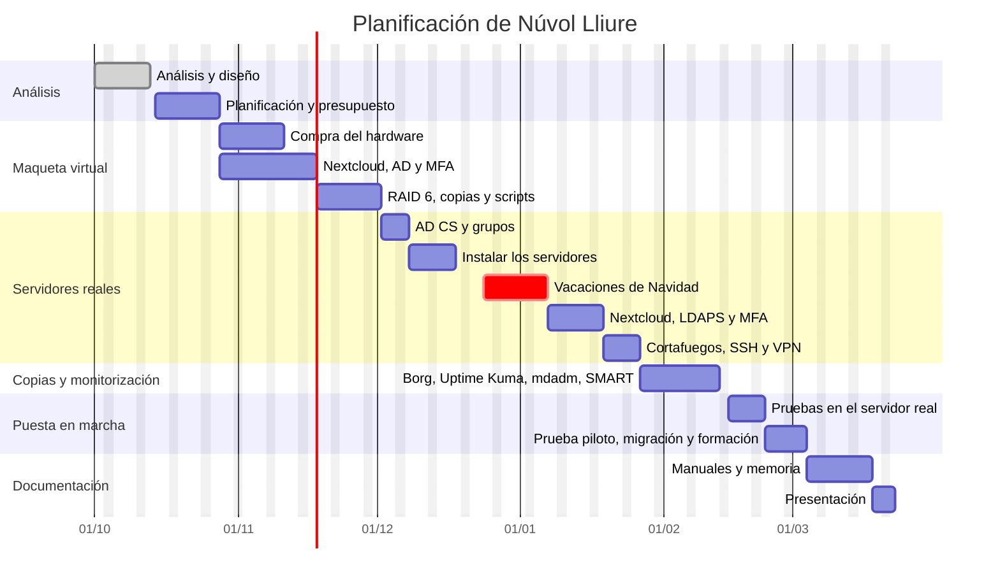

# Núvol Lliure

## Nube privada para Arrel Oberta

Proyecto Intermodular – 2.º CFGS ASIR

- **Alumno:** Jose Vicente Sanjuan Martinez
- **Curso:** 2.º CFGS Administración de Sistemas Informáticos en Red (ASIR)
- **Profesor/a:** (pendiente)
- **Fecha:** (pendiente)

---

# ÍNDICE

1. Presentación del proyecto
2. Introducción
3. Análisis del proyecto
4. Diseño de la solución
5. Planificación
6. Implantación y pruebas
7. Seguimiento y control
8. Resultados y conclusiones
9. Bibliografía/webgrafía y fuentes
10. Anexos
11. Documentación técnica
12. Presentación y defensa

---

# 1. PRESENTACIÓN DEL PROYECTO

Núvol Lliure es una nube privada hecha con software libre que permite guardar, sincronizar y compartir archivos sin depender de servicios como Google Drive o OneDrive.

El proyecto consiste en implantarla en Arrel Oberta, una consultoría de unos 50 trabajadores. La empresa tiene un servidor Windows con Active Directory que también hace de servidor de archivos, donde cada trabajador tiene su carpeta.

La idea es mantener Active Directory para los usuarios y añadir dos servidores Linux: uno para la nube (Nextcloud) y otro para las copias de seguridad y la monitorización. Así los trabajadores podrán acceder a sus archivos desde la oficina y desde fuera.

La solución está pensada para que sea funcional y fácil de mantener, y para que pueda utilizarse tanto en una organización como en un entorno doméstico. Si no hay Active Directory, como pasa en casa, Nextcloud puede funcionar con sus propios usuarios y el resto de la instalación es la misma. De hecho, una vez terminado el proyecto, la intención es utilizarla también como servidor personal.

---

# 2. INTRODUCCIÓN

## 2.1 Título del proyecto

Núvol Lliure – Nube privada para Arrel Oberta

## 2.2 Resumen

Arrel Oberta es una consultoría de unos 50 trabajadores. Los usuarios se gestionan con Active Directory en un servidor Windows, que también guarda la carpeta de cada trabajador. Estas carpetas solo se pueden utilizar desde la red de la oficina, y eso es un problema para los trabajadores que tienen que salir a visitar clientes o que trabajan desde casa.

Para solucionarlo se implantará una nube privada con Nextcloud, instalada con Docker en un servidor Ubuntu Server. Los trabajadores entrarán con el mismo usuario y contraseña que en Windows y podrán utilizar sus archivos desde el navegador, desde el programa de escritorio o desde el móvil.

Además, la instalación tendrá HTTPS, autenticación en dos pasos (MFA), cuatro discos en RAID 6 para que no se pierdan datos aunque fallen dos discos a la vez, copias de seguridad automáticas en otro servidor, monitorización de los servicios y de los discos y algunos scripts para automatizar el mantenimiento.

Antes de instalarlo en los servidores reales, todo se probará en un entorno virtual (máquinas virtuales) para no afectar al trabajo de la empresa.

El resultado esperado es que cada trabajador pueda acceder a sus archivos desde cualquier lugar, compartirlos con los compañeros y recuperarlos si hay algún problema, sin pagar licencias y con los datos dentro de la empresa.

## 2.3 Justificación

El proyecto nace de dos problemas de Arrel Oberta:

- **No se puede acceder a los archivos desde fuera.** El equipo comercial necesita sus documentos cuando visita clientes y ahora no puede. Algunos trabajadores han empezado a utilizar su Google Drive o Dropbox personal, y eso hace que información de la empresa esté fuera de su control.
- **La información no está bien protegida.** El servidor actual no tiene RAID ni copias de seguridad organizadas. Si falla el disco se puede perder todo.

Una nube privada soluciona las dos cosas, y además los datos siguen dentro de la empresa y no hay que pagar por cada usuario.

Con este proyecto se ponen en práctica cosas vistas durante el ciclo: administración de Linux y Windows Server, Active Directory, redes, contenedores Docker, almacenamiento con RAID, seguridad, copias de seguridad, monitorización, virtualización y scripts. También se utilizan Git y GitHub para guardar la documentación y las configuraciones.

## 2.4 Objetivos

### Objetivo general

Implantar una nube privada segura para Arrel Oberta que permita a los trabajadores guardar, sincronizar y compartir sus archivos con su usuario de Active Directory.

### Objetivos específicos

- Instalar Nextcloud con Docker en Ubuntu Server.
- Conectar Nextcloud con Active Directory.
- Probarlo todo en un entorno virtual antes de instalarlo en los servidores reales.
- Pasar las carpetas de los trabajadores del servidor Windows a Nextcloud.
- Poder compartir archivos entre usuarios y departamentos.
- Acceder desde dentro y desde fuera de la oficina con HTTPS y MFA.
- Gestionar usuarios, grupos y permisos.
- Proteger los datos con un RAID 6 y vigilar el estado de los discos.
- Hacer copias de seguridad automáticas y comprobar que se pueden restaurar.
- Monitorizar los servidores y recibir avisos cuando algo falle.
- Hacer scripts para las tareas de mantenimiento.
- Documentar la instalación y cómo recuperar el sistema para que pueda volver a desplegarse.

---

# 3. ANÁLISIS DEL PROYECTO

## 3.1 Situación actual

Arrel Oberta tiene unos 50 trabajadores repartidos en cinco departamentos: Recursos Humanos, Administración, Sistemas, Comercial y Dirección.

Ahora mismo tienen un servidor Windows que hace de:

- **Active Directory y DNS**, para los usuarios, grupos y equipos.
- **Servidor de archivos**, donde cada trabajador tiene una carpeta con permisos NTFS para que solo pueda entrar él.

Cuando dos trabajadores tienen que pasarse documentos lo hacen por correo o con un USB, y acaban teniendo varias versiones del mismo documento. Tampoco se puede entrar a las carpetas desde fuera de la oficina.

Problemas detectados:

- No hay acceso a los archivos desde fuera de la oficina.
- Compartir archivos entre compañeros es incómodo.
- Algunos trabajadores utilizan servicios en la nube personales.
- No hay RAID: si el disco falla se pueden perder los datos.
- No hay una política de copias de seguridad ni se ha probado nunca una restauración.
- No hay ningún sistema que avise si un servicio deja de funcionar.

## 3.2 Necesidades

**Funcionales:**

- Cada trabajador debe tener su espacio para guardar archivos.
- Los archivos se deben poder utilizar desde el navegador, el ordenador y el móvil.
- Se debe poder compartir con compañeros o con un departamento.
- Se debe poder acceder desde dentro y desde fuera de la oficina.

**Técnicas:**

- La nube debe ir en un servidor Linux aparte, no en el Windows.
- Active Directory debe seguir siendo donde se gestionan los usuarios.
- Hay que migrar las carpetas que hay ahora.
- Hay que probarlo todo antes en un entorno que no afecte a los trabajadores.

**De seguridad:**

- Cada usuario solo debe ver sus archivos y los que le comparten.
- Las conexiones desde fuera deben ir cifradas.
- Hace falta autenticación en dos pasos (MFA).
- Solo se debe abrir a Internet lo imprescindible.

**De disponibilidad:**

- Si fallan hasta dos discos no se deben perder datos.
- Hay que saber cuándo un disco empieza a fallar, antes de que se rompa.
- Hay que hacer copias de seguridad en otro equipo y probar que funcionan.
- Hay que saber cuándo cae un servicio.

**Económicas:**

- Utilizar software libre para no pagar licencias.
- Que se pueda ampliar si la empresa crece.

## 3.3 Requisitos

| ID | Tipo | Requisito | Prioridad | Cómo se comprobará |
|---|---|---|---|---|
| RF-01 | Funcional | Cada usuario tiene su espacio para guardar archivos. | Alta | Subir, modificar, descargar y borrar archivos. |
| RF-02 | Funcional | Se puede acceder desde la red de la oficina. | Alta | Entrar desde un equipo de la oficina. |
| RF-03 | Funcional | Se puede acceder desde Internet. | Alta | Entrar desde una red de fuera. |
| RF-04 | Funcional | Se pueden compartir archivos con usuarios o grupos, con permiso de lectura o de edición. | Alta | Compartir una carpeta y comprobar los permisos. |
| RF-05 | Funcional | Las carpetas del servidor Windows se migran a Nextcloud. | Alta | Comparar el número de archivos y el tamaño antes y después. |
| RF-06 | Funcional | Los archivos se sincronizan en el ordenador y el móvil. | Media | Instalar el cliente y comprobar que sincroniza. |
| RT-01 | Técnico | Nextcloud funciona en un servidor Linux. | Alta | Comprobar el servidor instalado. |
| RT-02 | Técnico | Los usuarios entran con su cuenta de Active Directory. | Alta | Iniciar sesión con un usuario de AD. |
| RT-03 | Técnico | Todo se prueba antes en un entorno virtual. | Alta | Instalar y probar la configuración en máquinas virtuales antes de pasarla a los servidores reales. |
| RS-01 | Seguridad | Hay que iniciar sesión para ver los archivos. | Alta | Intentar entrar sin iniciar sesión. |
| RS-02 | Seguridad | Los usuarios utilizan MFA. | Alta | Comprobar que pide el segundo paso. |
| RS-03 | Seguridad | El acceso web es por HTTPS. | Alta | Comprobar el certificado en el navegador. |
| RS-04 | Seguridad | Un usuario no puede ver archivos de otros si no se los han compartido. | Alta | Intentar entrar a los archivos de otro usuario. |
| RD-01 | Disponibilidad | Los datos están en un RAID 6 de cuatro discos. | Alta | Marcar dos discos como fallados (`mdadm --fail`) y comprobar que todo sigue funcionando. |
| RD-02 | Disponibilidad | Se hacen copias automáticas en otro servidor. | Alta | Comprobar que la copia de la noche se ha hecho. |
| RD-03 | Disponibilidad | Las copias se pueden restaurar. | Alta | Borrar un archivo y recuperarlo de la copia. |
| RM-01 | Monitorización | Se vigilan los servidores, los servicios, los certificados, el RAID y el estado de los discos. | Alta | Parar un servicio, simular el fallo de un disco y comprobar que llegan los avisos. |
| RA-01 | Automatización | Las copias y las comprobaciones de espacio están automatizadas. | Media | Comprobar que los scripts se ejecutan solos y avisan si hay un problema. |
| RE-01 | Escalabilidad | Se puede ampliar el espacio. | Media | Documentar cómo ampliar el RAID cambiando los discos por otros de más capacidad. |
| RDOC-01 | Documentación | Están documentadas la instalación y la recuperación. | Alta | Seguir la documentación para volver a instalar. |

## 3.4 Análisis de soluciones existentes

**Servicios en la nube pública.** La primera opción sería pagar Google Workspace o Microsoft 365. Son fáciles de utilizar, pero:

- Los datos se guardan en servidores de otras empresas.
- Cuestan unos 14 dólares por usuario y mes (unos 8.400 dólares al año para 50 trabajadores).
- La empresa depende del proveedor.

Por eso se ha optado por una nube privada instalada en la empresa. Se han estudiado tres programas:

- **Nextcloud:** el más conocido. Tiene integración con Active Directory, MFA, aplicaciones para todos los sistemas y mucha documentación.
- **ownCloud Infinite Scale:** la versión nueva de ownCloud. Es rápida, pero para conectarla bien con Active Directory hay que instalar un servicio de identidad aparte.
- **Seafile:** muy rápido sincronizando archivos, pero tiene menos funciones y algunas solo están en la versión de pago.

| Característica | Nextcloud | ownCloud Infinite Scale | Seafile |
|---|---|---|---|
| Software libre | Sí | Sí | Sí (versión comunitaria) |
| Sincronizar y compartir | Sí | Sí | Sí |
| Integración con Active Directory | Directa | Con un servicio extra | Directa |
| MFA | Sí | Con un servicio extra | Limitado |
| Funciona con Docker | Sí | Sí | Sí |
| Documentación | Mucha | Menos | Bastante |
| Precio | Gratuito | Gratuito | Gratuito (Pro de pago) |

## 3.5 Análisis DAFO

| Fortalezas | Debilidades |
|---|---|
| Los datos se quedan en la empresa. | Hay que mantener los servidores. |
| No se pagan licencias. | Más trabajo para el departamento de Sistemas. |
| Se aprovechan los usuarios de Active Directory. | Hay que migrar los datos actuales. |
| Acceso desde cualquier lugar. | Los usuarios se tienen que acostumbrar a la nueva herramienta. |
| RAID 6, copias y monitorización desde el principio. | Hay que saber de Linux y Docker. |

| Oportunidades | Amenazas |
|---|---|
| Facilitar el teletrabajo. | Ataques desde Internet. |
| Dejar de utilizar nubes personales. | Vulnerabilidades en el software. |
| Añadir más aplicaciones en el futuro. | Averías de hardware. |
| Crecer con la empresa. | Errores de configuración. |

---

# 4. DISEÑO DE LA SOLUCIÓN

## 4.1 Recopilación de información técnica

Para hacer el diseño se ha consultado sobre todo la documentación oficial de cada programa (apartado 9). Las tecnologías que se utilizarán son:

- **Nextcloud:** la plataforma de nube. Se han consultado los requisitos, la integración con LDAP/Active Directory, el MFA y cómo hacer copias.
- **Ubuntu Server 26.04 LTS:** el sistema operativo de los servidores Linux, con soporte durante años.
- **Docker y Docker Compose:** para instalar Nextcloud y lo que necesita en contenedores con un solo archivo.
- **MariaDB y Redis:** la base de datos y la memoria caché que recomienda Nextcloud.
- **Caddy:** proxy inverso que pone HTTPS automáticamente.
- **Let's Encrypt:** certificados HTTPS gratuitos.
- **Active Directory y AD CS:** para los usuarios y para generar el certificado necesario para LDAPS.
- **mdadm:** para hacer el RAID 6 por software y vigilar su estado.
- **ext4:** el sistema de archivos de los datos.
- **smartmontools (SMART):** para vigilar la salud física de los discos.
- **BorgBackup:** para las copias de seguridad.
- **Uptime Kuma:** para vigilar que los servidores, los servicios y los certificados funcionan.
- **VirtualBox:** para hacer las pruebas en máquinas virtuales antes de instalarlo en los servidores reales.
- **WireGuard:** VPN para administrar los servidores desde fuera.

## 4.2 Arquitectura

```text
                                  INTERNET
                                      │
                              ┌───────┴────────┐
                              │ Router de      │  Puertos abiertos hacia NUVOL01:
                              │ la empresa     │  · 443/tcp   (HTTPS)
                              └───────┬────────┘  · 51820/udp (VPN)
                                      │
                           LAN 192.168.10.0/24
       ┌──────────────────┬───────────┴──────┬──────────────────┐
       │                  │                  │                  │
┌──────┴────────┐ ┌───────┴───────────┐ ┌────┴─────────────┐ ┌──┴─────────┐
│ DC01          │ │ NUVOL01           │ │ BACKUP01         │ │ Equipos    │
│ Windows Server│ │ Ubuntu Server     │ │ Ubuntu Server    │ │ Windows 11 │
│ · AD DS       │ │ · Docker          │ │ · Copias (Borg)  │ │ · Navegador│
│ · DNS         │◄┤   - Caddy         │ │ · Uptime Kuma    │ │ · Cliente  │
│ · AD CS       │ │   - Nextcloud     ├─►                  │ │  Nextcloud │
│               │ │   - MariaDB/Redis │ │                  │ │ · Móviles  │
│               │ │ · SSD (sistema)   │ │                  │ │            │
│               │ │ · RAID 6 (datos)  │ │                  │ │            │
└───────────────┘ └───────────────────┘ └──────────────────┘ └────────────┘
```

- **DC01:** el servidor Windows que ya existe. Sigue con Active Directory y DNS, y se le añade AD CS para los certificados.
- **NUVOL01:** el servidor nuevo donde va Nextcloud, con el sistema en un SSD y los datos en cuatro discos en RAID 6.
- **BACKUP01:** un ordenador reaprovechado que guarda las copias y tiene la monitorización.
- **Equipos:** los ordenadores y móviles de los trabajadores.
- **Router:** solo abre a Internet el puerto de HTTPS y el de la VPN hacia NUVOL01.

**Cómo funciona:**

1. El usuario entra en `https://nuvol.arreloberta.com`. Desde la oficina el DNS de AD lo lleva directamente a NUVOL01 y desde fuera entra por el router.
2. Nextcloud comprueba el usuario y la contraseña en Active Directory (LDAPS) y después pide el código del MFA.
3. Cada noche NUVOL01 envía una copia a BACKUP01.
4. Uptime Kuma comprueba que todo funciona y envía un correo si algo cae. Además, `mdadm`, SMART y los scripts avisan si falla un disco, si queda poco espacio o si una copia no se ha hecho.
5. Para administrar los servidores desde fuera se utiliza la VPN.

## 4.3 Estudio de viabilidad técnica

**Técnicamente** es viable: todo el software es libre y muy utilizado, y para 50 usuarios no hace falta un servidor muy potente. Con 10 GB por usuario hacen falta unos 500 GB, y el RAID 6 de 8 TB útiles deja mucho margen. La red y la fibra de la oficina ya son suficientes; solo hay que abrir dos puertos en el router.

**Económicamente** también: no se pagan licencias. Solo hay que comprar el servidor, unos discos, un SSD y un SAI. En comparación, Google Workspace o Microsoft 365 costarían unos 8.400 dólares cada año. El presupuesto está en el apartado 5.4.

### 4.3.1 Alternativas

Para la plataforma de nube se comparan las tres opciones del apartado 3.4:

- **A – Nextcloud**
- **B – ownCloud Infinite Scale**
- **C – Seafile**

### 4.3.2 Comparativa

Puntuación de 1 (mal) a 5 (muy bien):

| Criterio | Nextcloud | ownCloud Infinite Scale | Seafile | Observaciones |
|---|---|---|---|---|
| Integración con AD | 5 | 3 | 4 | oCIS necesita un servicio de identidad extra |
| Documentación | 5 | 3 | 4 | Nextcloud tiene mucha más información |
| MFA | 5 | 3 | 3 | Nextcloud lo trae incluido |
| Facilidad de administración | 4 | 3 | 4 | oCIS es más complicado |
| Funciones | 5 | 4 | 3 | Compartir, clientes, aplicaciones |
| Rendimiento | 3 | 5 | 5 | Nextcloud mejora con Redis |
| **Total** | **27** | **21** | **23** | |

### 4.3.3 Elección y justificación

Se ha elegido **Nextcloud** porque es la que mejor puntuación tiene en lo que más importa para el proyecto: se conecta directamente con Active Directory, trae MFA, tiene aplicaciones para todos los dispositivos y tiene mucha documentación. Es un poco más lenta, pero para 50 usuarios no es un problema, y con Redis mejora.

Para el resto de componentes también se han estudiado alternativas:

| Componente | Elegido | Otras opciones | Por qué |
|---|---|---|---|
| Base de datos | MariaDB | PostgreSQL, SQLite | Es la más utilizada con Nextcloud. |
| Proxy | Caddy | Nginx, Traefik | Pone HTTPS solo y se configura con pocas líneas. |
| RAID | RAID 6 con mdadm | RAID 5, RAID 10, ZFS | Aguanta que fallen dos discos cualesquiera. RAID 5 solo aguanta uno, y con discos de 4 TB la reconstrucción tarda muchas horas. RAID 10 da el mismo espacio y es más rápido, pero solo aguanta dos fallos si son de parejas diferentes. ZFS es más complejo. |
| Sistema operativo | SSD aparte | Sistema dentro del RAID | El sistema queda separado de los datos: se puede reinstalar Ubuntu sin tocar el RAID. |
| Sistema de archivos | ext4, sin LVM | ext4 con LVM, XFS | ext4 es el estándar de Ubuntu y sin LVM la administración es más sencilla. |
| Copias | BorgBackup | rsync, Restic | Hace copias incrementales y cifradas. |
| Monitorización | Uptime Kuma, `mdadm`, SMART y scripts | Zabbix, Grafana | Mucho más fácil de configurar y cubre lo necesario: servicios, RAID, discos, espacio y copias. |
| Pruebas | Máquinas virtuales con VirtualBox | Un servidor de pruebas físico | No hay que comprar nada y se pueden hacer y deshacer pruebas sin riesgo. |

## 4.4 Diseño detallado

| Elemento | Tecnología | Configuración | Justificación |
|---|---|---|---|
| Red | Red de la oficina | 192.168.10.0/24, puerta de enlace .1 | Ya existe. |
| DNS | DNS de AD y DNS público | `nuvol.arreloberta.com` → 192.168.10.20 (interno) e IP pública (externo) | La misma dirección funciona desde dentro y desde fuera. |
| Router | Router de la oficina | Abrir 443/tcp y 51820/udp hacia NUVOL01 | Abrir solo lo necesario. |
| VPN | WireGuard | Red 10.10.10.0/24 | Administrar desde fuera. |
| DC01 | Windows Server 2022 | 192.168.10.10. AD DS, DNS y AD CS | Ya existe; AD CS para LDAPS. |
| NUVOL01 | HPE MicroServer Gen11 + Ubuntu Server | 32 GB RAM, SSD NVMe de 500 GB para el sistema, 4 × 4 TB en RAID 6, IP .20 | Servidor de la nube. |
| BACKUP01 | PC reaprovechado + Ubuntu Server | 8 GB RAM, disco de 4 TB, IP .30 | Copias y monitorización. |
| SAI | APC Back-UPS 950 VA | Conectado a NUVOL01 y BACKUP01 | Proteger de los cortes de luz. |
| Contenedores | Docker Compose | Caddy, Nextcloud, cron, MariaDB, Redis | Todo en un archivo. |

El dominio de Active Directory es `corp.arreloberta.com`, que es un subdominio del dominio de la empresa, como recomienda Microsoft.

**Contenedores.** En NUVOL01 hay cinco contenedores: `caddy` (HTTPS, es el único que abre puertos), `nextcloud`, `cron` (tareas de Nextcloud), `mariadb` y `redis`. Todo está en un `docker-compose.yml` y las contraseñas en un archivo `.env` que no se sube a GitHub. Caddy pide solo el certificado a Let's Encrypt.

**Pruebas en entorno virtual.** Antes de tocar los servidores reales, se monta una maqueta con VirtualBox: una máquina virtual con Windows Server (AD) y otra con Ubuntu Server y cuatro discos virtuales. Ahí se prueba la instalación de Nextcloud, la conexión con AD, el MFA, el RAID 6 (simulando el fallo de discos), las copias y los scripts. Como la maqueta no depende del hardware, se puede hacer mientras se espera a que llegue. Después de la puesta en marcha también servirá para probar las actualizaciones antes de aplicarlas.

**Active Directory.** Nextcloud se conecta a DC01 por LDAPS (puerto 636) con una cuenta de solo lectura (`svc-nextcloud`). Solo pueden entrar los miembros del grupo `GG_Nuvol_Usuaris`, y el usuario es el mismo que en Windows. Si se deshabilita una cuenta en AD, esa persona ya no puede entrar a la nube. También se crean grupos por departamento para poder compartir con todo un departamento, y una UO `Proves` con usuarios de prueba para las pruebas.

**Archivos de los usuarios.** Cada trabajador tiene su espacio, como la carpeta que tenía antes, con una cuota de 10 GB. Puede compartir archivos con compañeros o departamentos con permiso de lectura o de edición. Los enlaces para gente de fuera deben llevar contraseña y fecha de caducidad. Nextcloud guarda versiones antiguas y tiene papelera, así que el usuario puede recuperar archivos él mismo.

**Discos.** El MicroServer tiene cuatro bahías de 3,5". Las cuatro se utilizan para discos de 4 TB en **RAID 6** con mdadm, formateado en ext4 y montado en `/srv/nuvol`. Da unos 8 TB útiles y sigue funcionando aunque fallen dos discos. El sistema (Ubuntu) va en un **SSD NVMe** aparte, conectado con un adaptador PCIe, porque no quedan bahías libres. En la BIOS la controladora se pone en modo SATA AHCI para que Ubuntu vea los discos directamente.

Para ampliar el espacio en el futuro, se pueden cambiar los discos uno a uno por otros de más capacidad y hacer crecer el RAID (`mdadm --grow`) y el sistema de archivos (`resize2fs`).

**Migración.** Cuando todo funcione en la maqueta virtual y las copias estén en marcha:

1. Instalar en NUVOL01 la misma configuración probada en las máquinas virtuales.
2. Comprobar en el servidor real el acceso desde fuera, el RAID, los avisos y las copias.
3. Una semana de prueba con el departamento de Sistemas.
4. Un viernes por la tarde, poner las carpetas antiguas en solo lectura y copiarlas a Nextcloud con `rsync`. Después, `occ files:scan --all` y comprobar que no falta nada.
5. El lunes, explicar a los trabajadores cómo funciona.

Si algo va mal, se vuelve a dar permiso de escritura a las carpetas antiguas y se sigue trabajando como antes, porque los datos originales no se han tocado.

**Requisitos y dónde se cumplen:**

| Requisito | Solución |
|---|---|
| RF-01, RF-04, RS-01, RS-04 | Espacios personales y compartición de Nextcloud |
| RF-02, RF-03 | DNS interno y puertos abiertos en el router |
| RF-05 | Migración con `rsync` |
| RF-06 | Cliente de escritorio y app móvil |
| RT-01, RT-02 | Nextcloud en Ubuntu con LDAPS contra AD |
| RT-03 | Maqueta virtual con VirtualBox |
| RS-02 | MFA obligatorio |
| RS-03 | HTTPS con Caddy |
| RD-01 | RAID 6 con mdadm |
| RD-02, RD-03 | BorgBackup en BACKUP01 |
| RM-01 | Uptime Kuma, `mdadm`, SMART y scripts |
| RA-01 | Scripts de copia y de comprobación con `cron` |
| RE-01 | Ampliación del RAID con `mdadm --grow` |
| RDOC-01 | Manuales del apartado 11 |

Las direcciones IP, los nombres de los equipos y los recursos de hardware indicados son una propuesta inicial y se pueden ajustar durante la implantación. Los cambios que se hagan se recogerán en el apartado 7.3 (Cambios realizados).

## 4.5 Seguridad

| Riesgo | Medidas |
|---|---|
| Ataques desde Internet | Solo se abren los puertos 443 y 51820. Cortafuegos UFW en los servidores. |
| Robo de contraseñas | MFA obligatorio y protección contra fuerza bruta de Nextcloud. |
| Que alguien vea el tráfico | HTTPS para la web y LDAPS entre Nextcloud y AD. |
| Acceso a los servidores | SSH solo con clave, sin `root` y solo desde dentro o por VPN. |
| Software desactualizado | Actualizaciones automáticas de Ubuntu y actualizaciones de Nextcloud probadas primero en la maqueta virtual y hechas después de una copia. |
| Avería de discos | RAID 6, avisos de `mdadm` y SMART y copias en otro servidor. |
| Contraseñas en GitHub | Archivo `.env` fuera del repositorio. |
| Ransomware o archivos borrados | Copias cifradas en otro servidor y en un disco externo. |

## 4.6 Copias de seguridad y recuperación

Se sigue la **regla 3-2-1**: tres copias, en dos soportes diferentes y una fuera de la oficina.

- **Qué se copia:** los datos de los usuarios, la configuración de Nextcloud y Docker y la base de datos. En DC01 se hace copia del estado del sistema con Windows Server Backup.
- **Cuándo:** cada noche a las 02:00 con `cron`, y también antes de hacer cambios.
- **Dónde:** en el RAID de NUVOL01, en BACKUP01 y en un disco externo que se lleva fuera de la oficina. Los discos de copia son de 4 TB: para los unos 500 GB previstos sobra espacio, y si los datos pasaran de unos 3 TB habría que ampliarlos.
- **Cuántas se guardan:** 7 diarias, 4 semanales y 6 mensuales.
- **Herramienta:** BorgBackup, con el repositorio cifrado. NUVOL01 envía las copias por SSH con clave.

El script de copia hace: poner Nextcloud en mantenimiento, exportar la base de datos, hacer la copia con Borg, sacar Nextcloud del mantenimiento, borrar las copias viejas y avisar a Uptime Kuma del resultado. Si la copia no avisa, llega una alerta.

**Restaurar:**

- **Un archivo:** si está en la papelera de Nextcloud lo recupera el usuario. Si no, se saca de la copia de Borg.
- **Todo el servicio:** instalar el servidor siguiendo el manual, recuperar los datos y la base de datos de Borg y arrancar los contenedores.

Cada mes se probará a restaurar un archivo y una vez al año se hará una restauración completa en una máquina virtual.

## 4.7 Monitorización y mantenimiento

La monitorización es una parte obligatoria del proyecto, porque el servidor no avisa de ninguna manera cuando falla un disco. Se hace con cuatro herramientas:

| Herramienta | Qué vigila | Aviso |
|---|---|---|
| Uptime Kuma (en BACKUP01) | Que NUVOL01 y DC01 responden, que la web de Nextcloud funciona y que el certificado HTTPS no caduca | Correo |
| `mdadm --monitor` | Discos fallados y RAID degradado | Correo |
| smartmontools (`smartd`) | Salud física de los discos (sectores defectuosos, temperatura...) | Correo |
| Scripts Bash con `cron` | Espacio libre y resultado de las copias | Aviso a Uptime Kuma |

Uptime Kuma va en BACKUP01, así si cae NUVOL01 puede seguir avisando.

**Mantenimiento:**

| Tarea | Cada cuánto |
|---|---|
| Revisar avisos y copias | Cada semana |
| Actualizar Nextcloud y los contenedores (primero en la maqueta virtual) | Cada mes |
| Revisar el estado SMART de los discos | Cada mes |
| Probar a restaurar un archivo | Cada mes |
| Cambiar el disco externo | Cada mes |
| Restauración completa de prueba | Cada año |

Si hay una avería se seguirá el manual de recuperación (apartado 11.4) y se anotará en el registro de incidencias (apartado 7.2).

## 4.8 Fases del proyecto

| Fase | Qué se hace | Horas |
|---|---|---|
| F1. Análisis y diseño | Analizar la situación, requisitos, alternativas y diseño | 15 h |
| F2. Planificación | Riesgos, tareas, presupuesto y compra del hardware | 8 h |
| F3. Maqueta virtual | Probar Nextcloud, AD, MFA, RAID 6, copias y scripts en máquinas virtuales | 20 h |
| F4. Preparar los servidores | Instalar el hardware, el SSD, Ubuntu, el RAID 6 y AD CS | 12 h |
| F5. Instalación y seguridad | Nextcloud, HTTPS, LDAPS, MFA, cortafuegos, SSH y VPN | 14 h |
| F6. Copias y monitorización | Borg, Uptime Kuma, `mdadm`, SMART y scripts | 13 h |
| F7. Pruebas y puesta en marcha | Pruebas en el servidor real, prueba piloto, migración y formación | 13 h |
| F8. Documentación | Manuales, memoria y presentación | 15 h |
| **Total** | | **110 h** |

---

# 5. PLANIFICACIÓN

## 5.1 Análisis de riesgos

| ID | Riesgo | Prob. | Impacto | Nivel | Prevención | Contingencia |
|---|---|---|---|---|---|---|
| R01 | No tener suficiente tiempo | Media | Alto | Alto | Reservar horas cada semana | Hacer primero lo más importante |
| R02 | Problemas con LDAPS y los certificados | Alta | Medio | Alto | Instalar AD CS al principio y probarlo en la maqueta virtual | Revisar el certificado del DC |
| R03 | El hardware tarda en llegar | Media | Medio | Medio | Comprarlo pronto | Adelantar la maqueta virtual y la documentación |
| R04 | Perder datos en la migración | Baja | Alto | Medio | Hacer copia antes y dejar las carpetas antiguas en solo lectura | Volver a las carpetas antiguas |
| R05 | Una actualización rompe Nextcloud | Media | Medio | Medio | Probarla primero en la maqueta virtual y hacer copia antes | Volver a la versión anterior |
| R06 | A los usuarios les cuesta adaptarse | Media | Medio | Medio | Prueba piloto y formación | Ayudarles las primeras semanas |
| R07 | Subir contraseñas a GitHub | Baja | Alto | Medio | `.gitignore` y archivo `.env` | Cambiar las contraseñas |
| R08 | Falla el SSD del sistema | Baja | Medio | Medio | Configuración en Git y en las copias | Cambiar el SSD y reinstalar siguiendo el manual; los datos del RAID no se pierden |

## 5.2 Tareas y distribución temporal

El proyecto lo realiza el técnico del departamento de Sistemas, dedicándole unas 5–6 horas por semana.

| ID | Tarea | Responsable | Depende de | Horas | Resultado |
|---|---|---|---|---|---|
| T01 | Análisis y diseño | Técnico | — | 15 h | Apartados 1–4 |
| T02 | Planificación y presupuesto | Técnico | T01 | 8 h | Apartado 5 |
| T03 | Aprobación y compra del hardware | Dirección | T02 | 2 semanas | Hardware |
| T04 | Maqueta virtual: Nextcloud, AD, LDAPS y MFA | Técnico | T02 | 12 h | Configuración probada |
| T05 | Maqueta virtual: RAID 6, copias y scripts | Técnico | T04 | 8 h | Procedimientos probados |
| T06 | AD CS, grupos y cuenta de servicio en DC01 | Técnico | T04 | 4 h | AD preparado |
| T07 | Instalar NUVOL01 y BACKUP01 (SSD, Ubuntu, RAID 6) | Técnico | T03, T05 | 8 h | Servidores preparados |
| T08 | Nextcloud, HTTPS, LDAPS y MFA en NUVOL01 | Técnico | T06, T07 | 8 h | Nextcloud funcionando |
| T09 | Cortafuegos, SSH y VPN | Técnico | T07 | 6 h | Servidores protegidos |
| T10 | Copias y monitorización (Borg, Uptime Kuma, `mdadm`, SMART) | Técnico | T08 | 13 h | Copias y avisos |
| T11 | Pruebas en el servidor real | Técnico | T09, T10 | 6 h | Pruebas hechas |
| T12 | Prueba piloto, migración y formación | Técnico | T11 | 7 h | Servicio en marcha |
| T13 | Manuales, memoria y presentación | Técnico | T12 | 15 h | Documentación |

### Diagrama de Gantt



Hitos principales:

- **Noviembre 2026:** maqueta virtual funcionando.
- **Diciembre 2026:** servidores reales preparados.
- **Enero 2027:** Nextcloud funcionando en el servidor real, con AD y MFA.
- **Febrero 2027:** copias y monitorización funcionando.
- **Marzo 2027:** servicio en producción y proyecto terminado.

## 5.3 Alojamiento

Se podría poner el servidor en la oficina, alquilarlo en un proveedor o hacer una mezcla. Se ha elegido **ponerlo en la oficina** porque Active Directory ya está allí, la mayoría de accesos son desde dentro y la idea es que los datos no salgan de la empresa. El inconveniente es que para el acceso desde fuera depende de la fibra de la oficina.

## 5.4 Recursos y presupuesto

**Personas:** el técnico de Sistemas (unas 110 h), la Dirección (aprueba el presupuesto) y los trabajadores (prueba piloto y una hora de formación).

Precios con IVA, consultados en octubre y noviembre de 2026:

| Recurso | Cantidad | Precio | Total | Fuente |
|---|---|---|---|---|
| Servidor HPE MicroServer Gen11 (32 GB, 2 × 4 TB) | 1 | 3.643 € | 3.643 € | InMac |
| PC reaprovechado para BACKUP01 | 1 | 0 € | 0 € | Equipo de la empresa |
| Disco WD Red Plus 4 TB (2 para completar el RAID 6 y 1 para BACKUP01) | 3 | 233 € | 699 € | PcComponentes |
| SSD NVMe 500 GB (sistema) | 1 | 161 € | 161 € | PowerPlanet |
| Adaptador PCIe a M.2 NVMe | 1 | 14 € | 14 € | PcComponentes |
| Disco externo WD Elements 4 TB | 2 | 202 € | 404 € | MediaMarkt |
| SAI APC Back-UPS 950 VA | 1 | 144 € | 144 € | PcComponentes |
| Software | — | 0 € | 0 € | Software libre |
| Horas del técnico (22 €/h) | 110 h | 22 € | 2.420 € | Sueldo medio (Indeed) |
| **Total** | | | **7.485 €** | |

Gastos de cada año: dominio (unos 14 €), mantenimiento (unas 4 horas al mes, unos 1.050 €) y luz (unos 120 €). En total, **unos 1.200 € al año**.

El precio por hora se ha calculado a partir del sueldo medio de un administrador de sistemas (unos 29.700 € al año según Indeed) más lo que paga la empresa a la Seguridad Social.

## 5.5 Monetización/retorno

El proyecto no genera ingresos, pero ahorra lo que costaría Google Workspace o Microsoft 365: unos 7.500 € al año para 50 trabajadores.

| | Año 1 | Año 2 | Año 3 |
|---|---|---|---|
| Núvol Lliure | 8.685 € | 1.200 € | 1.200 € |
| Google / Microsoft | 7.500 € | 7.500 € | 7.500 € |

El primer año cuesta un poco más, pero a partir del segundo se ahorran unos 6.300 € cada año. En tres años el ahorro es de unos 11.400 €. La inversión se recupera en poco más de un año.

Hay que tener en cuenta que Google y Microsoft también incluyen correo y ofimática, así que la comparación es solo para la parte de archivos.

## 5.6 Requisitos legales, normativos y éticos

Arrel Oberta guarda datos personales de trabajadores y clientes, por lo que debe cumplir el **RGPD** (Reglamento UE 2016/679) y la **LOPDGDD** (Ley Orgánica 3/2018). Núvol Lliure ayuda a cumplirlos porque:

- Los datos están protegidos con HTTPS, MFA, permisos, RAID y copias cifradas, como pide el artículo 32 del RGPD.
- Los datos se quedan en la oficina, dentro de la Unión Europea.
- La monitorización ayuda a detectar problemas de seguridad.

La empresa tendrá que añadir Núvol Lliure a su registro de actividades de tratamiento e informar a los trabajadores.

Todo el software es libre (Nextcloud tiene licencia AGPLv3, por ejemplo) y se utiliza sin modificar, así que no hay ningún problema de licencias. Windows Server ya lo tiene la empresa.

Los administradores solo entrarán a los archivos de los usuarios cuando haga falta para arreglar un problema. En la maqueta virtual solo se utilizan usuarios y archivos de prueba.

## 5.7 Gestión documental

Todo el proyecto está en un repositorio privado de GitHub:

- `docs/`: la memoria (en valenciano y en castellano) y las imágenes.
- `docker/`: el `docker-compose.yml`.
- `config/`: configuración de Caddy, WireGuard, etc.
- `scripts/`: scripts de copia, restauración y mantenimiento.

Se hace un commit cada vez que se cambia algo y las contraseñas no se suben nunca (van en el `.env`, que está en el `.gitignore`).

---

# 6. IMPLANTACIÓN Y PRUEBAS

## 6.1 Preparación del entorno

*Pendiente.*

## 6.2 Instalación y configuración

*Pendiente.*

## 6.3 Automatización

*Pendiente.*

## 6.4 Plan de pruebas

*Pendiente.*

### 6.4.1 Resultados de las pruebas

*Pendiente.*

### 6.4.2 Producto mínimo viable (PMV)

*Pendiente.*

---

# 7. SEGUIMIENTO Y CONTROL

## 7.1 Evolución del proyecto

*Pendiente.*

## 7.2 Registro de incidencias

*Pendiente.*

## 7.3 Cambios realizados

*Pendiente.*

---

# 8. RESULTADOS Y CONCLUSIONES

## 8.1 Resultados obtenidos

*Pendiente.*

## 8.2 Grado de consecución de los objetivos

*Pendiente.*

## 8.3 Incidencias y dificultades

*Pendiente.*

## 8.4 Nivel de satisfacción

*Pendiente.*

## 8.5 Propuestas de mejora

*Pendiente.*

---

# 9. BIBLIOGRAFÍA/WEBGRAFÍA Y FUENTES

| Fuente | Tipo | URL | Para qué se ha utilizado |
|---|---|---|---|
| Manual de administración de Nextcloud | Documentación oficial | https://docs.nextcloud.com/server/stable/admin_manual/ | Instalación, LDAP, MFA y copias |
| Imagen Docker de Nextcloud | Documentación oficial | https://github.com/nextcloud/docker | Instalar Nextcloud con Docker |
| Documentación de ownCloud Infinite Scale | Documentación oficial | https://doc.owncloud.com/ocis/next/admin/index.html | Comparativa |
| Manual de Seafile | Documentación oficial | https://manual.seafile.com/ | Comparativa |
| Documentación de Ubuntu Server | Documentación oficial | https://documentation.ubuntu.com/server/ | Administración de Ubuntu |
| Microsoft Learn – Active Directory | Documentación oficial | https://learn.microsoft.com/en-us/windows-server/identity/ad-ds/plan/selecting-the-forest-root-domain | Nombre del dominio de AD |
| Documentación de Docker | Documentación oficial | https://docs.docker.com/ | Docker y Docker Compose |
| Documentación de Caddy | Documentación oficial | https://caddyserver.com/docs/ | Proxy y HTTPS |
| Documentación de BorgBackup | Documentación oficial | https://borgbackup.readthedocs.io/ | Copias de seguridad |
| INCIBE – Copias de seguridad | Organismo público | https://www.incibe.es/empresas/blog/copias-seguridad-guia-aproximacion-el-empresario | Política de copias |
| Uptime Kuma | Repositorio oficial | https://github.com/louislam/uptime-kuma | Monitorización |
| Página de manual de mdadm | Documentación oficial | https://man7.org/linux/man-pages/man8/mdadm.8.html | RAID 6 y monitorización del RAID |
| smartmontools | Documentación oficial | https://www.smartmontools.org/ | Salud de los discos (SMART) |
| Intra2net – HPE MicroServer Gen11 | Artículo técnico | https://www-ro01.intra2net.com/en/support/hpe-microserver-g11.php | Bahías, modo AHCI y M.2 del servidor |
| Documentación de VirtualBox | Documentación oficial | https://www.virtualbox.org/manual/ | Maqueta virtual |
| WireGuard | Documentación oficial | https://www.wireguard.com/ | VPN |
| eesel AI – Precios de Google Workspace | Artículo | https://www.eesel.ai/es/blog/google-workspace-pricing | Precio de Google Workspace |
| Nordflux – Precios de Microsoft 365 | Artículo | https://nordflux.de/es/conocimiento/microsoft-365-subida-de-precios-2026 | Precio de Microsoft 365 |
| Comparador de precios – HPE MicroServer | Tienda | https://www.comparateur-gamer.fr/prix/hpe-serveur-hpe-proliant-microserver-gen11-intel-xeon-e-190017748306 | Precio del servidor |
| PcComponentes / MediaMarkt / PowerPlanet | Tienda | https://www.pccomponentes.com · https://www.mediamarkt.es · https://www.powerplanetonline.com | Precio de los discos, el SSD, el adaptador y el SAI |
| Indeed – Sueldo de administrador de sistemas | Estadística | https://es.indeed.com/salaries/administrador-de-sistemas-Salaries | Precio por hora del técnico |
| RGPD | Normativa | https://eur-lex.europa.eu/eli/reg/2016/679/oj | Protección de datos |
| LOPDGDD | Normativa | https://www.boe.es/eli/es/lo/2018/12/05/3/con | Protección de datos |

## Uso de herramientas de inteligencia artificial

Durante la elaboración del proyecto se ha utilizado un asistente de inteligencia artificial (Claude, de Anthropic) como herramienta de apoyo para:

- Organizar la memoria según la plantilla del proyecto.
- Proponer y comparar alternativas técnicas.
- Buscar documentación oficial y precios de referencia.
- Revisar y mejorar la redacción.

Todas las propuestas se han revisado y las decisiones finales las ha tomado el alumno, que es quien realiza la instalación, la configuración y las pruebas de la infraestructura.

---

# 10. ANEXOS

*Pendiente.*

---

# 11. DOCUMENTACIÓN TÉCNICA

## 11.1 Manual de instalación

*Pendiente.*

## 11.2 Manual de administración

*Pendiente.*

## 11.3 Manual de usuario

*Pendiente.*

## 11.4 Manual de recuperación

*Pendiente.*

---

# 12. PRESENTACIÓN Y DEFENSA

## 12.1 Estructura de la presentación

*Pendiente.*

## 12.2 Demostración

*Pendiente.*

## 12.3 Preguntas previsibles

*Pendiente.*
