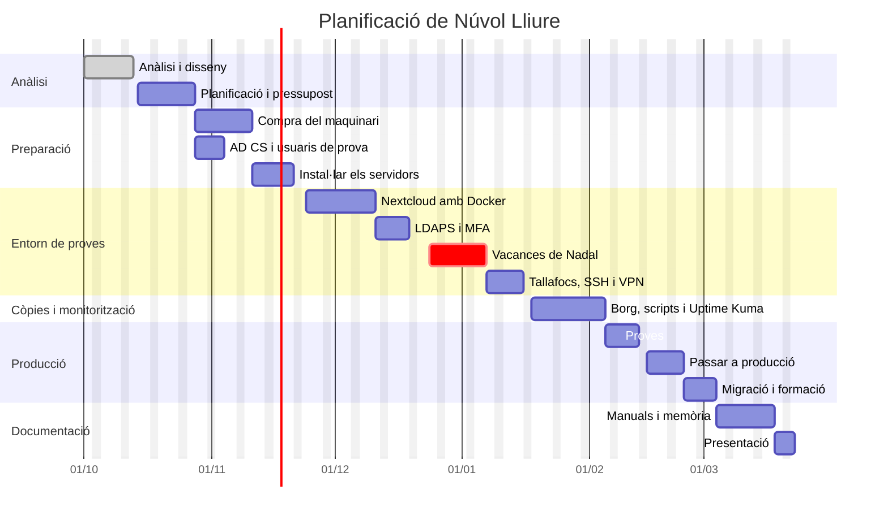

# Núvol Lliure

## Cloud privada per a Arrel Oberta

Projecte Intermodular – 2n CFGS ASIR

- **Alumne:** Jose Vicente Sanjuan Martinez
- **Curs:** 2n CFGS Administració de Sistemes Informàtics en Xarxa (ASIR)
- **Professor/a:** (pendent)
- **Data:** (pendent)

---

# ÍNDEX

1. Presentació del projecte
2. Introducció
3. Anàlisi del projecte
4. Disseny de la solució
5. Planificació
6. Implantació i proves
7. Seguiment i control
8. Resultats i conclusions
9. Bibliografia/webgrafia i fonts
10. Annexos
11. Documentació tècnica
12. Presentació i defensa

---

# 1. PRESENTACIÓ DEL PROJECTE

Núvol Lliure és una cloud privada feta amb programari lliure que permet guardar, sincronitzar i compartir fitxers sense dependre de serveis com Google Drive o OneDrive.

El projecte consisteix a implantar-la en Arrel Oberta, una consultoria d'uns 50 treballadors. L'empresa té un servidor Windows amb Active Directory que també fa de servidor de fitxers, on cada treballador té la seua carpeta.

La idea és mantindre Active Directory per als usuaris i afegir dos servidors Linux: un per a la cloud (Nextcloud) i un altre per a les còpies de seguretat i la monitorització. Així els treballadors podran accedir als seus fitxers des de l'oficina i des de fora.

---

# 2. INTRODUCCIÓ

## 2.1 Títol del projecte

Núvol Lliure – Cloud privada per a Arrel Oberta

## 2.2 Resum

Arrel Oberta és una consultoria d'uns 50 treballadors. Els usuaris es gestionen amb Active Directory en un servidor Windows, que també guarda la carpeta de cada treballador. Estes carpetes només es poden utilitzar des de la xarxa de l'oficina, i això és un problema per als treballadors que han d'eixir a visitar clients o que treballen des de casa.

Per solucionar-ho s'implantarà una cloud privada amb Nextcloud, instal·lada amb Docker en un servidor Ubuntu Server. Els treballadors entraran amb el mateix usuari i contrasenya que en Windows i podran utilitzar els seus fitxers des del navegador, des del programa d'escriptori o des del mòbil.

A més, la instal·lació tindrà HTTPS, autenticació en dos passos (MFA), dos discos en RAID 1 perquè no es perden dades si un disc falla, còpies de seguretat automàtiques en un altre servidor, monitorització dels serveis i alguns scripts per automatitzar el manteniment.

Abans de passar-ho a producció, tot es provarà en un entorn de proves (preproducció) per no afectar el treball de l'empresa.

El resultat esperat és que cada treballador puga accedir als seus fitxers des de qualsevol lloc, compartir-los amb els companys i recuperar-los si hi ha algun problema, sense pagar llicències i amb les dades dins de l'empresa.

## 2.3 Justificació

El projecte naix de dos problemes d'Arrel Oberta:

- **No es pot accedir als fitxers des de fora.** L'equip comercial necessita els seus documents quan visita clients i ara no pot. Alguns treballadors han començat a utilitzar el seu Google Drive o Dropbox personal, i això fa que informació de l'empresa estiga fora del seu control.
- **La informació no està ben protegida.** El servidor actual no té RAID ni còpies de seguretat organitzades. Si falla el disc es pot perdre tot.

Una cloud privada soluciona les dues coses, i a més les dades continuen dins de l'empresa i no cal pagar per cada usuari.

Amb este projecte es posen en pràctica coses vistes durant el cicle: administració de Linux i Windows Server, Active Directory, xarxes, contenidors Docker, seguretat, còpies de seguretat, monitorització i scripts. També s'utilitza Git i GitHub per guardar la documentació i les configuracions.

## 2.4 Objectius

### Objectiu general

Implantar una cloud privada segura per a Arrel Oberta que permeta als treballadors guardar, sincronitzar i compartir els seus fitxers amb el seu usuari d'Active Directory.

### Objectius específics

- Instal·lar Nextcloud amb Docker en Ubuntu Server.
- Connectar Nextcloud amb Active Directory.
- Provar-ho tot en un entorn de proves abans de passar-ho a producció.
- Passar les carpetes dels treballadors del servidor Windows a Nextcloud.
- Poder compartir fitxers entre usuaris i departaments.
- Accedir des de dins i des de fora de l'oficina amb HTTPS i MFA.
- Protegir les dades amb un RAID 1.
- Fer còpies de seguretat automàtiques i comprovar que es poden restaurar.
- Monitoritzar els servidors i rebre avisos quan alguna cosa falle.
- Fer scripts per a les tasques de manteniment.
- Documentar la instal·lació i com recuperar el sistema.

---

# 3. ANÀLISI DEL PROJECTE

## 3.1 Situació actual

Arrel Oberta té uns 50 treballadors repartits en cinc departaments: Recursos Humans, Administració, Sistemes, Comercial i Direcció.

Ara mateix tenen un servidor Windows que fa:

- **Active Directory i DNS**, per als usuaris, grups i equips.
- **Servidor de fitxers**, on cada treballador té una carpeta amb permisos NTFS perquè només hi puga entrar ell.

Quan dos treballadors s'han de passar documents ho fan per correu o amb un USB, i acaben tenint diverses versions del mateix document. Tampoc es pot entrar a les carpetes des de fora de l'oficina.

Problemes que s'han detectat:

- No hi ha accés als fitxers des de fora de l'oficina.
- Compartir fitxers entre companys és incòmode.
- Alguns treballadors utilitzen serveis cloud personals.
- No hi ha RAID: si el disc falla es poden perdre les dades.
- No hi ha una política de còpies de seguretat ni s'ha provat mai una restauració.
- No hi ha cap sistema que avise si un servei deixa de funcionar.
- Els canvis es fan directament sobre el servidor que utilitzen els treballadors, sense provar-los abans.

## 3.2 Necessitats

**Funcionals:**

- Cada treballador ha de tindre el seu espai per guardar fitxers.
- Els fitxers s'han de poder utilitzar des del navegador, l'ordinador i el mòbil.
- S'ha de poder compartir amb companys o amb un departament.
- S'ha de poder accedir des de dins i des de fora de l'oficina.

**Tècniques:**

- La cloud ha d'anar en un servidor Linux a part, no en el Windows.
- Active Directory ha de continuar sent on es gestionen els usuaris.
- S'han de migrar les carpetes que hi ha ara.
- Cal un entorn de proves per no fer proves en producció.

**De seguretat:**

- Cada usuari només ha de veure els seus fitxers i els que li compartixen.
- Les connexions des de fora han d'anar xifrades.
- Cal autenticació en dos passos (MFA).
- Només s'ha d'obrir a Internet el que siga imprescindible.

**De disponibilitat:**

- Si falla un disc no s'han de perdre dades.
- Cal fer còpies de seguretat en un altre equip i provar que funcionen.
- Cal saber quan cau un servei.

**Econòmiques:**

- Utilitzar programari lliure per no pagar llicències.
- Que es puga ampliar si l'empresa creix.

## 3.3 Requisits

| ID | Tipus | Requisit | Prioritat | Com es comprovarà |
|---|---|---|---|---|
| RF-01 | Funcional | Cada usuari té el seu espai per guardar fitxers. | Alta | Pujar, modificar, descarregar i esborrar fitxers. |
| RF-02 | Funcional | Es pot accedir des de la xarxa de l'oficina. | Alta | Entrar des d'un equip de l'oficina. |
| RF-03 | Funcional | Es pot accedir des d'Internet. | Alta | Entrar des d'una xarxa de fora. |
| RF-04 | Funcional | Es poden compartir fitxers amb usuaris o grups, amb permís de lectura o d'edició. | Alta | Compartir una carpeta i comprovar els permisos. |
| RF-05 | Funcional | Les carpetes del servidor Windows es migren a Nextcloud. | Alta | Comparar el nombre de fitxers i la mida abans i després. |
| RF-06 | Funcional | Els fitxers es sincronitzen en l'ordinador i el mòbil. | Mitjana | Instal·lar el client i comprovar que sincronitza. |
| RT-01 | Tècnic | Nextcloud funciona en un servidor Linux. | Alta | Comprovar el servidor instal·lat. |
| RT-02 | Tècnic | Els usuaris entren amb el seu compte d'Active Directory. | Alta | Iniciar sessió amb un usuari d'AD. |
| RT-03 | Tècnic | Hi ha un entorn de proves separat de producció. | Alta | Provar una actualització primer en proves. |
| RS-01 | Seguretat | Cal iniciar sessió per veure els fitxers. | Alta | Intentar entrar sense iniciar sessió. |
| RS-02 | Seguretat | Els usuaris utilitzen MFA. | Alta | Comprovar que demana el segon pas. |
| RS-03 | Seguretat | L'accés web és per HTTPS. | Alta | Comprovar el certificat en el navegador. |
| RS-04 | Seguretat | Un usuari no pot veure fitxers d'altres si no li'ls han compartit. | Alta | Intentar entrar als fitxers d'un altre usuari. |
| RD-01 | Disponibilitat | Els discos estan en RAID 1. | Alta | Desconnectar un disc i comprovar que tot continua funcionant. |
| RD-02 | Disponibilitat | Es fan còpies automàtiques en un altre servidor. | Alta | Comprovar que la còpia de la nit s'ha fet. |
| RD-03 | Disponibilitat | Les còpies es poden restaurar. | Alta | Esborrar un fitxer i recuperar-lo de la còpia. |
| RM-01 | Monitorització | Es vigilen els servidors i serveis. | Mitjana | Parar un servei i comprovar que arriba l'avís. |
| RA-01 | Automatització | Almenys una tasca està automatitzada. | Mitjana | Comprovar que l'script s'executa sol. |
| RDOC-01 | Documentació | Està documentada la instal·lació i la recuperació. | Alta | Seguir la documentació per tornar a instal·lar. |

## 3.4 Anàlisi de solucions existents

**Serveis al núvol públic.** La primera opció seria pagar Google Workspace o Microsoft 365. Són fàcils d'utilitzar, però:

- Les dades es guarden en servidors d'altres empreses.
- Costen uns 14 dòlars per usuari i mes (uns 8.400 dòlars a l'any per a 50 treballadors).
- L'empresa depén del proveïdor.

Per això s'ha optat per una cloud privada instal·lada a l'empresa. S'han mirat tres programes:

- **Nextcloud:** el més conegut. Té integració amb Active Directory, MFA, aplicacions per a tots els sistemes i molta documentació.
- **ownCloud Infinite Scale:** la versió nova d'ownCloud. És ràpida, però per connectar-la bé amb Active Directory cal instal·lar un servei d'identitat a part.
- **Seafile:** molt ràpid sincronitzant fitxers, però té menys funcions i algunes només estan en la versió de pagament.

| Característica | Nextcloud | ownCloud Infinite Scale | Seafile |
|---|---|---|---|
| Programari lliure | Sí | Sí | Sí (versió comunitària) |
| Sincronitzar i compartir | Sí | Sí | Sí |
| Integració amb Active Directory | Directa | Amb un servei extra | Directa |
| MFA | Sí | Amb un servei extra | Limitat |
| Funciona amb Docker | Sí | Sí | Sí |
| Documentació | Molta | Menys | Bastant |
| Preu | Gratuït | Gratuït | Gratuït (Pro de pagament) |

## 3.5 Anàlisi DAFO

| Fortaleses | Debilitats |
|---|---|
| Les dades es queden a l'empresa. | Cal mantindre els servidors. |
| No es paguen llicències. | Més feina per al departament de Sistemes. |
| S'aprofiten els usuaris d'Active Directory. | Cal migrar les dades actuals. |
| Accés des de qualsevol lloc. | Els usuaris s'han d'acostumar a la nova eina. |
| RAID, còpies i monitorització des del principi. | Cal saber de Linux i Docker. |

| Oportunitats | Amenaces |
|---|---|
| Facilitar el teletreball. | Atacs des d'Internet. |
| Deixar d'utilitzar clouds personals. | Vulnerabilitats en el programari. |
| Afegir més aplicacions en el futur. | Avaries de maquinari. |
| Créixer amb l'empresa. | Errors de configuració. |

---

# 4. DISSENY DE LA SOLUCIÓ

## 4.1 Recopilació d'informació tècnica

Per fer el disseny s'ha consultat sobretot la documentació oficial de cada programa (apartat 9). Les tecnologies que s'utilitzaran són:

- **Nextcloud:** la plataforma de cloud. S'han consultat els requisits, la integració amb LDAP/Active Directory, l'MFA i com fer còpies.
- **Ubuntu Server 26.04 LTS:** el sistema operatiu dels servidors Linux, amb suport durant anys.
- **Docker i Docker Compose:** per instal·lar Nextcloud i el que necessita en contenidors amb un sol fitxer.
- **MariaDB i Redis:** la base de dades i la memòria cau que recomana Nextcloud.
- **Caddy:** proxy invers que posa HTTPS automàticament.
- **Let's Encrypt:** certificats HTTPS gratuïts.
- **Active Directory i AD CS:** per als usuaris i per generar el certificat que cal per a LDAPS.
- **mdadm i LVM:** per fer el RAID 1 i poder ampliar el disc.
- **BorgBackup:** per a les còpies de seguretat.
- **Uptime Kuma:** per a la monitorització.
- **WireGuard:** VPN per administrar els servidors des de fora.

## 4.2 Arquitectura

```text
                                  INTERNET
                                      │
                              ┌───────┴────────┐
                              │ Router de      │  Ports oberts cap a NUVOL01:
                              │ l'empresa      │  · 443/tcp   (HTTPS)
                              └───────┬────────┘  · 51820/udp (VPN)
                                      │
                           LAN 192.168.10.0/24
       ┌──────────────────┬───────────┴──────┬──────────────────┐
       │                  │                  │                  │
┌──────┴────────┐ ┌───────┴───────────┐ ┌────┴─────────────┐ ┌──┴─────────┐
│ DC01          │ │ NUVOL01           │ │ BACKUP01         │ │ Equips     │
│ Windows Server│ │ Ubuntu Server     │ │ Ubuntu Server    │ │ Windows 11 │
│ · AD DS       │ │ · Docker          │ │ · Còpies (Borg)  │ │ · Navegador│
│ · DNS         │◄┤   - Caddy         │ │ · Uptime Kuma    │ │ · Client   │
│ · AD CS       │ │   - Nextcloud     ├─► · Entorn de      │ │  Nextcloud │
│               │ │   - MariaDB/Redis │ │   proves         │ │ · Mòbils   │
│               │ │ · RAID 1          │ │                  │ │            │
└───────────────┘ └───────────────────┘ └──────────────────┘ └────────────┘
```

- **DC01:** el servidor Windows que ja hi ha. Continua amb Active Directory i DNS, i s'hi afegix AD CS per als certificats.
- **NUVOL01:** el servidor nou on va Nextcloud (producció), amb dos discos en RAID 1.
- **BACKUP01:** un ordinador reaprofitat que guarda les còpies, té la monitorització i l'entorn de proves.
- **Equips:** els ordinadors i mòbils dels treballadors.
- **Router:** només obri a Internet el port de HTTPS i el de la VPN cap a NUVOL01.

**Com funciona:**

1. L'usuari entra en `https://nuvol.arreloberta.com`. Des de l'oficina el DNS d'AD el porta directament a NUVOL01 i des de fora entra pel router.
2. Nextcloud comprova l'usuari i la contrasenya en Active Directory (LDAPS) i després demana el codi de l'MFA.
3. Cada nit NUVOL01 envia una còpia a BACKUP01.
4. Uptime Kuma comprova que tot funciona i envia un correu si alguna cosa cau.
5. Per administrar els servidors des de fora s'utilitza la VPN.

## 4.3 Estudi de viabilitat tècnica

**Tècnicament** és viable: tot el programari és lliure i molt utilitzat, i per a 50 usuaris no cal un servidor molt potent. Amb 10 GB per usuari calen uns 500 GB, i el RAID 1 de 4 TB deixa molt de marge. La xarxa i la fibra de l'oficina ja són suficients; només cal obrir dos ports en el router.

**Econòmicament** també: no es paguen llicències. Només cal comprar el servidor, uns discos i un SAI. En comparació, Google Workspace o Microsoft 365 costarien uns 8.400 dòlars cada any. El pressupost està en l'apartat 5.4.

### 4.3.1 Alternatives

Per a la plataforma de cloud es comparen les tres opcions de l'apartat 3.4:

- **A – Nextcloud**
- **B – ownCloud Infinite Scale**
- **C – Seafile**

### 4.3.2 Comparativa

Puntuació de 1 (malament) a 5 (molt bé):

| Criteri | Nextcloud | ownCloud Infinite Scale | Seafile | Observacions |
|---|---|---|---|---|
| Integració amb AD | 5 | 3 | 4 | oCIS necessita un servei d'identitat extra |
| Documentació | 5 | 3 | 4 | Nextcloud té molta més informació |
| MFA | 5 | 3 | 3 | Nextcloud el porta inclòs |
| Facilitat d'administració | 4 | 3 | 4 | oCIS és més complicat |
| Funcions | 5 | 4 | 3 | Compartir, clients, aplicacions |
| Rendiment | 3 | 5 | 5 | Nextcloud millora amb Redis |
| **Total** | **27** | **21** | **23** | |

### 4.3.3 Elecció i justificació

S'ha triat **Nextcloud** perquè és la que millor puntuació té en el que més importa per al projecte: es connecta directament amb Active Directory, porta MFA, té aplicacions per a tots els dispositius i té molta documentació. És un poc més lenta, però per a 50 usuaris no és un problema, i amb Redis millora.

Per a la resta de coses també s'han mirat alternatives:

| Component | Triat | Altres opcions | Per què |
|---|---|---|---|
| Base de dades | MariaDB | PostgreSQL, SQLite | És la més utilitzada amb Nextcloud. |
| Proxy | Caddy | Nginx, Traefik | Posa HTTPS sol i es configura amb poques línies. |
| RAID | mdadm (RAID 1) | ZFS | Més senzill i suficient. |
| Còpies | BorgBackup | rsync, Restic | Fa còpies incrementals i xifrades. |
| Monitorització | Uptime Kuma | Zabbix, Grafana | Molt més fàcil de configurar. |
| Entorn de proves | Docker en BACKUP01 | Comprar un altre servidor | No cal gastar més. |

## 4.4 Disseny detallat

| Element | Tecnologia | Configuració | Justificació |
|---|---|---|---|
| Xarxa | Xarxa de l'oficina | 192.168.10.0/24, porta d'enllaç .1 | Ja existix. |
| DNS | DNS d'AD i DNS públic | `nuvol.arreloberta.com` → 192.168.10.20 (intern) i IP pública (extern) | La mateixa adreça funciona des de dins i des de fora. |
| Router | Router de l'oficina | Obrir 443/tcp i 51820/udp cap a NUVOL01 | Obrir només el necessari. |
| VPN | WireGuard | Xarxa 10.10.10.0/24 | Administrar des de fora. |
| DC01 | Windows Server 2022 | 192.168.10.10. AD DS, DNS i AD CS | Ja existix; AD CS per a LDAPS. |
| NUVOL01 | HPE MicroServer Gen11 + Ubuntu Server | 32 GB RAM, 2 × 4 TB en RAID 1, IP .20 | Servidor de la cloud. |
| BACKUP01 | PC reaprofitat + Ubuntu Server | 8 GB RAM, disc de 4 TB, IP .30 | Còpies, monitorització i proves. |
| SAI | APC Back-UPS 950 VA | Connectat a NUVOL01 i BACKUP01 | Protegir dels talls de llum. |
| Contenidors | Docker Compose | Caddy, Nextcloud, cron, MariaDB, Redis | Tot en un fitxer. |

El domini d'Active Directory és `corp.arreloberta.com`, que és un subdomini del domini de l'empresa, com recomana Microsoft.

**Contenidors.** En NUVOL01 hi ha cinc contenidors: `caddy` (HTTPS, és l'únic que obri ports), `nextcloud`, `cron` (tasques de Nextcloud), `mariadb` i `redis`. Tot està en un `docker-compose.yml` i les contrasenyes en un fitxer `.env` que no es puja a GitHub. Caddy demana sol el certificat a Let's Encrypt.

**Entorn de proves.** En BACKUP01 s'instal·la el mateix `docker-compose.yml` amb usuaris i fitxers de prova, en l'adreça interna `nuvol-pre.corp.arreloberta.com`. No es pot accedir des d'Internet i té un certificat d'AD CS. Primer es prova tot ací i, si funciona, es passa a producció. Després de la posada en marxa també servirà per provar les actualitzacions.

**Active Directory.** Nextcloud es connecta a DC01 per LDAPS (port 636) amb un compte de només lectura (`svc-nextcloud`). Només poden entrar els membres del grup `GG_Nuvol_Usuaris`, i l'usuari és el mateix que en Windows. Si es deshabilita un compte en AD, eixa persona ja no pot entrar a la cloud. També es creen grups per departament per poder compartir amb tot un departament, i una UO `Proves` amb usuaris de prova.

**Fitxers dels usuaris.** Cada treballador té el seu espai, com la carpeta que tenia abans, amb una quota de 10 GB. Pot compartir fitxers amb companys o departaments amb permís de lectura o d'edició. Els enllaços per a gent de fora han de portar contrasenya i data de caducitat. Nextcloud guarda versions antigues i té paperera, així que l'usuari pot recuperar fitxers ell mateix.

**Discos.** Els dos discos de NUVOL01 van en RAID 1 amb mdadm: una part per al sistema (`md0`) i la resta per a les dades (`md1`, amb LVM, muntat en `/srv/nuvol`). Si falla un disc, el servidor continua funcionant amb l'altre. Amb LVM es pot ampliar l'espai afegint més discos.

**Migració.** Quan tot funcione en proves i les còpies estiguen en marxa:

1. Instal·lar en NUVOL01 la mateixa configuració que en proves.
2. Comprovar en producció l'accés des de fora, el RAID i les còpies.
3. Una setmana de prova amb el departament de Sistemes.
4. Un divendres per la vesprada, posar les carpetes antigues en només lectura i copiar-les a Nextcloud amb `rsync`. Després, `occ files:scan --all` i comprovar que no falta res.
5. El dilluns, explicar als treballadors com funciona.

Si alguna cosa va malament, es torna a donar permís d'escriptura a les carpetes antigues i es continua treballant com abans, perquè les dades originals no s'han tocat.

**Requisits i on es complixen:**

| Requisit | Solució |
|---|---|
| RF-01, RF-04, RS-01, RS-04 | Espais personals i compartició de Nextcloud |
| RF-02, RF-03 | DNS intern i ports oberts en el router |
| RF-05 | Migració amb `rsync` |
| RF-06 | Client d'escriptori i app mòbil |
| RT-01, RT-02 | Nextcloud en Ubuntu amb LDAPS contra AD |
| RT-03 | Entorn de proves en BACKUP01 |
| RS-02 | MFA obligatori |
| RS-03 | HTTPS amb Caddy |
| RD-01 | RAID 1 amb mdadm |
| RD-02, RD-03 | BorgBackup a BACKUP01 |
| RM-01 | Uptime Kuma |
| RA-01 | Script de còpia amb `cron` |
| RDOC-01 | Manuals de l'apartat 11 |

## 4.5 Seguretat

| Risc | Mesures |
|---|---|
| Atacs des d'Internet | Només s'obrin els ports 443 i 51820. Tallafocs UFW en els servidors. L'entorn de proves no es veu des de fora. |
| Robatori de contrasenyes | MFA obligatori i protecció contra força bruta de Nextcloud. |
| Que algú veja el trànsit | HTTPS per a la web i LDAPS entre Nextcloud i AD. |
| Accés als servidors | SSH només amb clau, sense `root` i només des de dins o per VPN. |
| Programari desactualitzat | Actualitzacions automàtiques d'Ubuntu i actualitzacions de Nextcloud provades primer en l'entorn de proves. |
| Contrasenyes a GitHub | Fitxer `.env` fora del repositori. |
| Ransomware o fitxers esborrats | Còpies xifrades en un altre servidor i en un disc extern. |

## 4.6 Còpies de seguretat i recuperació

Es seguix la **regla 3-2-1**: tres còpies, en dos suports diferents i una fora de l'oficina.

- **Què es copia:** les dades dels usuaris, la configuració de Nextcloud i Docker i la base de dades. En DC01 es fa còpia de l'estat del sistema amb Windows Server Backup.
- **Quan:** cada nit a les 02:00 amb `cron`, i també abans de fer canvis.
- **On:** en el RAID de NUVOL01, en BACKUP01 i en un disc extern que es porta fora de l'oficina.
- **Quantes es guarden:** 7 diàries, 4 setmanals i 6 mensuals.
- **Eina:** BorgBackup, amb el repositori xifrat. NUVOL01 envia les còpies per SSH amb clau.

L'script de còpia fa: posar Nextcloud en manteniment, exportar la base de dades, fer la còpia amb Borg, traure Nextcloud del manteniment i esborrar les còpies velles.

**Restaurar:**

- **Un fitxer:** si està a la paperera de Nextcloud el recupera l'usuari. Si no, es trau de la còpia de Borg.
- **Tot el servei:** instal·lar el servidor seguint el manual, recuperar les dades i la base de dades de Borg i arrancar els contenidors.

Cada mes es provarà a restaurar un fitxer i un cop a l'any es farà una restauració completa en l'entorn de proves.

## 4.7 Monitorització i manteniment

Uptime Kuma s'instal·la en BACKUP01, així si cau NUVOL01 continua podent avisar. Comprova:

- Que la web de Nextcloud respon.
- Que el certificat no caduca.
- Que NUVOL01 i DC01 responen.

A més, `mdadm` envia un correu si falla un disc i l'script de còpies avisa si la còpia falla.

**Manteniment:**

| Tasca | Cada quan |
|---|---|
| Revisar avisos i còpies | Cada setmana |
| Actualitzar Nextcloud i els contenidors (primer en proves) | Cada mes |
| Provar a restaurar un fitxer | Cada mes |
| Canviar el disc extern | Cada mes |
| Restauració completa de prova | Cada any |

Si hi ha una avaria se seguirà el manual de recuperació (apartat 11.4) i s'apuntarà en el registre d'incidències (apartat 7.2).

## 4.8 Fases del projecte

| Fase | Què es fa | Hores |
|---|---|---|
| F1. Anàlisi i disseny | Analitzar la situació, requisits, alternatives i disseny | 15 h |
| F2. Planificació | Riscos, tasques, pressupost i compra del maquinari | 8 h |
| F3. Preparar els servidors | Instal·lar el maquinari, Ubuntu, RAID i AD CS | 13 h |
| F4. Entorn de proves | Instal·lar Nextcloud amb Docker en BACKUP01 | 13 h |
| F5. AD i seguretat | LDAPS, MFA, tallafocs, SSH i VPN | 12 h |
| F6. Còpies i monitorització | Borg, scripts i Uptime Kuma | 13 h |
| F7. Proves i producció | Proves, instal·lar en NUVOL01, migració i formació | 21 h |
| F8. Documentació | Manuals, memòria i presentació | 15 h |
| **Total** | | **110 h** |

---

# 5. PLANIFICACIÓ

## 5.1 Anàlisi de riscos

| ID | Risc | Prob. | Impacte | Nivell | Prevenció | Contingència |
|---|---|---|---|---|---|---|
| R01 | No tindre prou temps | Mitjana | Alt | Alt | Reservar hores cada setmana | Fer primer el més important |
| R02 | Problemes amb LDAPS i els certificats | Alta | Mitjà | Alt | Instal·lar AD CS al principi i provar-ho en l'entorn de proves | Revisar el certificat del DC |
| R03 | El maquinari tarda a arribar | Mitjana | Mitjà | Mitjà | Comprar-lo prompte | Avançar les tasques d'AD i de documentació |
| R04 | Perdre dades en la migració | Baixa | Alt | Mitjà | Fer còpia abans i deixar les carpetes antigues en només lectura | Tornar a les carpetes antigues |
| R05 | Una actualització trenca Nextcloud | Mitjana | Mitjà | Mitjà | Provar-la primer en l'entorn de proves | Tornar a la versió anterior |
| R06 | Als usuaris els costa adaptar-se | Mitjana | Mitjà | Mitjà | Prova pilot i formació | Ajudar-los les primeres setmanes |
| R07 | Pujar contrasenyes a GitHub | Baixa | Alt | Mitjà | `.gitignore` i fitxer `.env` | Canviar les contrasenyes |

## 5.2 Tasques i distribució temporal

El projecte el fa el tècnic del departament de Sistemes, dedicant-li unes 5–6 hores per setmana.

| ID | Tasca | Responsable | Depén de | Hores | Resultat |
|---|---|---|---|---|---|
| T01 | Anàlisi i disseny | Tècnic | — | 15 h | Apartats 1–4 |
| T02 | Planificació i pressupost | Tècnic | T01 | 8 h | Apartat 5 |
| T03 | Aprovació i compra del maquinari | Direcció | T02 | 2 setmanes | Maquinari |
| T04 | AD CS, grups i usuaris de prova | Tècnic | T02 | 4 h | AD preparat |
| T05 | Instal·lar NUVOL01 i BACKUP01 (Ubuntu, RAID) | Tècnic | T03 | 9 h | Servidors preparats |
| T06 | Nextcloud amb Docker en l'entorn de proves | Tècnic | T05 | 13 h | Nextcloud de proves |
| T07 | LDAPS i MFA | Tècnic | T04, T06 | 6 h | Login amb AD i MFA |
| T08 | Tallafocs, SSH i VPN | Tècnic | T05 | 6 h | Servidors protegits |
| T09 | Còpies i monitorització | Tècnic | T06 | 13 h | Còpies i avisos |
| T10 | Proves en l'entorn de proves | Tècnic | T07, T08, T09 | 6 h | Proves fetes |
| T11 | Passar a producció i comprovar | Tècnic | T10 | 7 h | Producció funcionant |
| T12 | Prova pilot, migració i formació | Tècnic | T11 | 8 h | Servei en marxa |
| T13 | Manuals, memòria i presentació | Tècnic | T12 | 15 h | Documentació |

### Diagrama de Gantt



Fites principals:

- **Novembre 2026:** servidors preparats.
- **Desembre 2026:** Nextcloud funcionant en l'entorn de proves.
- **Gener 2027:** accés amb AD i MFA.
- **Febrer 2027:** còpies i monitorització funcionant.
- **Març 2027:** servei en producció i projecte acabat.

## 5.3 Allotjament

Es podria posar el servidor a l'oficina, llogar-lo en un proveïdor o fer una mescla. S'ha triat **posar-lo a l'oficina** perquè Active Directory ja està allí, la majoria d'accessos són des de dins i la idea és que les dades no isquen de l'empresa. L'inconvenient és que per a l'accés des de fora depén de la fibra de l'oficina.

## 5.4 Recursos i pressupost

**Persones:** el tècnic de Sistemes (unes 110 h), la Direcció (aprova el pressupost) i els treballadors (prova pilot i una hora de formació).

Preus amb IVA, consultats a l'octubre de 2026:

| Recurs | Quantitat | Preu | Total | Font |
|---|---|---|---|---|
| Servidor HPE MicroServer Gen11 (32 GB, 2 × 4 TB) | 1 | 3.643 € | 3.643 € | InMac |
| PC reaprofitat per a BACKUP01 | 1 | 0 € | 0 € | Equip de l'empresa |
| Disc WD Red Plus 4 TB | 1 | 233 € | 233 € | PcComponentes |
| Disc extern WD Elements 4 TB | 2 | 202 € | 404 € | MediaMarkt |
| SAI APC Back-UPS 950 VA | 1 | 144 € | 144 € | PcComponentes |
| Programari | — | 0 € | 0 € | Programari lliure |
| Hores del tècnic (22 €/h) | 110 h | 22 € | 2.420 € | Sou mitjà (Indeed) |
| **Total** | | | **6.844 €** | |

Despeses de cada any: domini (uns 14 €), manteniment (unes 4 hores al mes, uns 1.050 €) i llum (uns 120 €). En total, **uns 1.200 € a l'any**.

El preu per hora s'ha calculat a partir del sou mitjà d'un administrador de sistemes (uns 29.700 € a l'any segons Indeed) més el que paga l'empresa a la Seguretat Social.

## 5.5 Monetització/retorn

El projecte no dona diners, però estalvia el que costaria Google Workspace o Microsoft 365: uns 7.500 € a l'any per a 50 treballadors.

| | Any 1 | Any 2 | Any 3 |
|---|---|---|---|
| Núvol Lliure | 8.044 € | 1.200 € | 1.200 € |
| Google / Microsoft | 7.500 € | 7.500 € | 7.500 € |

El primer any costa més o menys el mateix, però a partir del segon s'estalvien uns 6.300 € cada any. En tres anys l'estalvi és de més de 12.000 €. La inversió es recupera en poc més d'un any.

Cal dir que Google i Microsoft també inclouen correu i ofimàtica, així que la comparació és només per a la part de fitxers.

## 5.6 Requisits legals, normatius i ètics

Arrel Oberta guarda dades personals de treballadors i clients, per tant ha de complir el **RGPD** (Reglament UE 2016/679) i la **LOPDGDD** (Llei Orgànica 3/2018). Núvol Lliure ajuda a complir-los perquè:

- Les dades estan protegides amb HTTPS, MFA, permisos, RAID i còpies xifrades, com demana l'article 32 del RGPD.
- Les dades es queden a l'oficina, dins de la Unió Europea.
- La monitorització ajuda a detectar problemes de seguretat.

L'empresa haurà d'afegir Núvol Lliure al seu registre d'activitats de tractament i informar els treballadors.

Tot el programari és lliure (Nextcloud té llicència AGPLv3, per exemple) i s'utilitza sense modificar, així que no hi ha cap problema de llicències. Windows Server ja el té l'empresa.

Els administradors només entraran als fitxers dels usuaris quan calga per arreglar un problema. En l'entorn de proves només s'utilitzen usuaris i fitxers de prova.

## 5.7 Gestió documental

Tot el projecte està en un repositori privat de GitHub:

- `docs/`: la memòria i les imatges.
- `docker/`: el `docker-compose.yml`.
- `config/`: configuració de Caddy, WireGuard, etc.
- `scripts/`: scripts de còpia, restauració i manteniment.

Es fa un commit cada vegada que es canvia alguna cosa i les contrasenyes no es pugen mai (van en el `.env`, que està en el `.gitignore`).

---

# 6. IMPLANTACIÓ I PROVES

## 6.1 Preparació de l'entorn

*Pendent.*

## 6.2 Instal·lació i configuració

*Pendent.*

## 6.3 Automatització

*Pendent.*

## 6.4 Pla de proves

*Pendent.*

### 6.4.1 Resultats de les proves

*Pendent.*

### 6.4.2 Producte mínim viable (PMV)

*Pendent.*

---

# 7. SEGUIMENT I CONTROL

## 7.1 Evolució del projecte

*Pendent.*

## 7.2 Registre d'incidències

*Pendent.*

## 7.3 Canvis realitzats

*Pendent.*

---

# 8. RESULTATS I CONCLUSIONS

## 8.1 Resultats obtinguts

*Pendent.*

## 8.2 Grau de consecució dels objectius

*Pendent.*

## 8.3 Incidències i dificultats

*Pendent.*

## 8.4 Nivell de satisfacció

*Pendent.*

## 8.5 Propostes de millora

*Pendent.*

---

# 9. BIBLIOGRAFIA/WEBGRAFIA I FONTS

| Font | Tipus | URL | Per a què s'ha utilitzat |
|---|---|---|---|
| Manual d'administració de Nextcloud | Documentació oficial | https://docs.nextcloud.com/server/stable/admin_manual/ | Instal·lació, LDAP, MFA i còpies |
| Imatge Docker de Nextcloud | Documentació oficial | https://github.com/nextcloud/docker | Instal·lar Nextcloud amb Docker |
| Documentació d'ownCloud Infinite Scale | Documentació oficial | https://doc.owncloud.com/ocis/next/admin/index.html | Comparativa |
| Manual de Seafile | Documentació oficial | https://manual.seafile.com/ | Comparativa |
| Documentació d'Ubuntu Server | Documentació oficial | https://documentation.ubuntu.com/server/ | Administració d'Ubuntu |
| Microsoft Learn – Active Directory | Documentació oficial | https://learn.microsoft.com/en-us/windows-server/identity/ad-ds/plan/selecting-the-forest-root-domain | Nom del domini d'AD |
| Documentació de Docker | Documentació oficial | https://docs.docker.com/ | Docker i Docker Compose |
| Documentació de Caddy | Documentació oficial | https://caddyserver.com/docs/ | Proxy i HTTPS |
| Documentació de BorgBackup | Documentació oficial | https://borgbackup.readthedocs.io/ | Còpies de seguretat |
| INCIBE – Còpies de seguretat | Organisme públic | https://www.incibe.es/empresas/blog/copias-seguridad-guia-aproximacion-el-empresario | Política de còpies |
| Uptime Kuma | Repositori oficial | https://github.com/louislam/uptime-kuma | Monitorització |
| WireGuard | Documentació oficial | https://www.wireguard.com/ | VPN |
| eesel AI – Preus de Google Workspace | Article | https://www.eesel.ai/es/blog/google-workspace-pricing | Preu de Google Workspace |
| Nordflux – Preus de Microsoft 365 | Article | https://nordflux.de/es/conocimiento/microsoft-365-subida-de-precios-2026 | Preu de Microsoft 365 |
| Comparador de preus – HPE MicroServer | Botiga | https://www.comparateur-gamer.fr/prix/hpe-serveur-hpe-proliant-microserver-gen11-intel-xeon-e-190017748306 | Preu del servidor |
| PcComponentes / MediaMarkt | Botiga | https://www.pccomponentes.com · https://www.mediamarkt.es | Preu dels discos i el SAI |
| Indeed – Sou d'administrador de sistemes | Estadística | https://es.indeed.com/salaries/administrador-de-sistemas-Salaries | Preu per hora del tècnic |
| RGPD | Normativa | https://eur-lex.europa.eu/eli/reg/2016/679/oj | Protecció de dades |
| LOPDGDD | Normativa | https://www.boe.es/eli/es/lo/2018/12/05/3/con | Protecció de dades |

---

# 10. ANNEXOS

*Pendent.*

---

# 11. DOCUMENTACIÓ TÈCNICA

## 11.1 Manual d'instal·lació

*Pendent.*

## 11.2 Manual d'administració

*Pendent.*

## 11.3 Manual d'usuari

*Pendent.*

## 11.4 Manual de recuperació

*Pendent.*

---

# 12. PRESENTACIÓ I DEFENSA

## 12.1 Estructura de la presentació

*Pendent.*

## 12.2 Demostració

*Pendent.*

## 12.3 Preguntes previsibles

*Pendent.*
