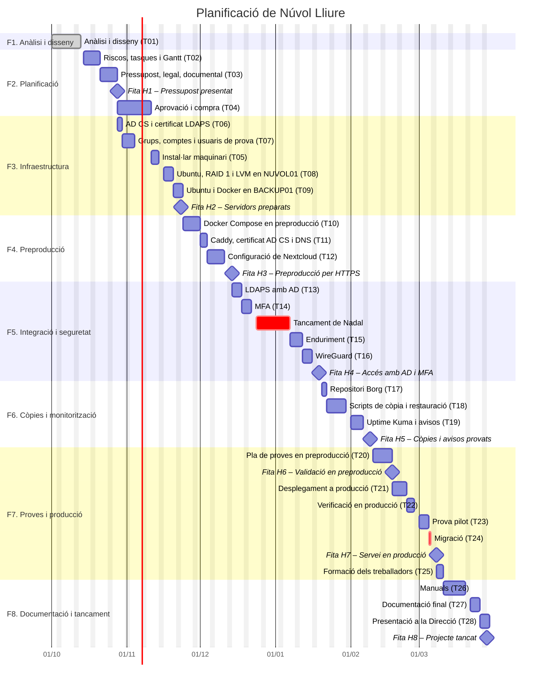

# Núvol Lliure

## Cloud privada per a Arrel Oberta

**Projecte Intermodular – 2n curs (ASIR)**

| | |
|---|---|
| **Títol del projecte** | Núvol Lliure – Cloud privada per a Arrel Oberta |
| **Alumne** | Jose Vicente Sanjuan Martinez |
| **Curs** | 2n CFGS Administració de Sistemes Informàtics en Xarxa (ASIR) |
| **Professor/a** | [Pendent] |
| **Data** | [Pendent] |

> 🚧 **Document en desenvolupament**
>
> Esta memòria s'anirà completant i actualitzant durant el desenvolupament del projecte.

---

# ÍNDEX

1. Presentació del projecte
2. Introducció
3. Anàlisi del projecte
4. Disseny de la solució
5. Planificació
6. Implantació i proves
7. Seguiment i control
8. Resultats i conclusions
9. Bibliografia/webgrafia i fonts
10. Annexos
11. Documentació tècnica
12. Presentació i defensa

---

# 1. PRESENTACIÓ DEL PROJECTE

**Núvol Lliure** és una cloud privada basada en programari lliure que permet guardar, sincronitzar i compartir fitxers sense dependre de serveis externs com Google Drive o OneDrive.

El projecte planteja la implantació de Núvol Lliure en **Arrel Oberta**, una consultoria d'aproximadament 50 treballadors. L'empresa disposa actualment d'un servidor Windows amb Active Directory que també s'utilitza com a servidor de fitxers, on cada treballador té la seua carpeta individual.

La proposta consisteix a mantindre Active Directory per a la gestió dels usuaris i afegir dos servidors Linux: un per a la cloud privada i un altre per a les còpies de seguretat, la monitorització i l'entorn de preproducció. Així, els treballadors podran accedir a la seua informació des de l'oficina i des de fora, de manera segura i sincronitzada en tots els seus dispositius.

La implantació seguix el mateix procés que qualsevol canvi important en un sistema en producció: tota la configuració es valida primer en un **entorn de preproducció**, i només quan les proves són correctes es fa el **desplegament a producció** i la migració de les dades, fora de l'horari laboral i amb un pla de marxa arrere.

Sempre que siga possible s'utilitzarà programari lliure i de codi obert, i es buscarà una solució funcional i fàcil de mantindre.

---

# 2. INTRODUCCIÓ

## 2.1 Títol del projecte

**Núvol Lliure – Cloud privada per a Arrel Oberta**

## 2.2 Resum

Arrel Oberta és una consultoria d'aproximadament 50 treballadors. Actualment, els usuaris es gestionen amb Active Directory en un servidor Windows, que també guarda la carpeta individual de cada treballador. Estes carpetes només són accessibles des de la xarxa de l'oficina, cosa que dificulta el treball fora de l'empresa.

La solució proposada és implantar **Núvol Lliure**, una cloud privada basada en **Nextcloud**, desplegada amb **Docker** sobre **Ubuntu Server**. Els treballadors continuaran iniciant sessió amb el seu usuari d'Active Directory i tindran la seua informació disponible des del navegador, des del client d'escriptori i des del mòbil.

La infraestructura inclourà accés segur per HTTPS, autenticació multifactor, emmagatzematge redundant amb RAID 1, còpies de seguretat en un segon servidor, monitorització dels serveis i scripts per automatitzar les tasques de manteniment.

La implantació es farà en dues etapes. Primer, la plataforma es desplegarà i es provarà en un **entorn de preproducció**, amb usuaris i fitxers de prova, sense afectar el treball diari. Després, la mateixa configuració validada es desplegarà en el **servidor de producció**, es verificarà, es farà una prova pilot amb un departament i es migraran les carpetes dels treballadors. L'entorn de preproducció es mantindrà després de la posada en marxa per provar les actualitzacions abans d'aplicar-les.

El resultat esperat és una cloud privada en producció, on cada treballador d'Arrel Oberta pot treballar amb els seus fitxers des de qualsevol lloc, compartir-los amb els companys i recuperar-los en cas d'error o avaria, amb un cost de llicències nul i amb tota la informació sota el control de l'empresa.

## 2.3 Justificació

El projecte naix de dues necessitats principals d'Arrel Oberta:

- **Accés des de fora de l'oficina.** Alguns treballadors, especialment l'equip comercial, necessiten consultar i modificar els seus documents quan visiten clients o treballen des de casa. Amb el sistema actual no és possible fer-ho de manera còmoda i segura, i alguns treballadors han començat a utilitzar serveis personals com Google Drive o Dropbox, de manera que informació de l'empresa queda fora del seu control.
- **Protecció de la informació.** El servidor actual no disposa de redundància d'emmagatzematge ni d'una política de còpies de seguretat definida. Una fallada del disc podria provocar la pèrdua de la informació dels treballadors.

Una cloud privada resol estes necessitats mantenint les dades dins de l'empresa i sense costos de llicències per usuari.

El projecte també servix perquè el departament de Sistemes incorpore bones pràctiques que fins ara no s'aplicaven: separar els entorns de **preproducció i producció**, provar els canvis abans d'aplicar-los, planificar els desplegaments amb un pla de marxa arrere i documentar la infraestructura perquè es puga tornar a desplegar.

Per a això s'utilitzaran **Git i GitHub**, que permeten controlar les versions de la documentació, les configuracions i els scripts, i desplegar en producció exactament la mateixa configuració que s'ha provat en preproducció.

## 2.4 Objectius

### Objectiu general

Implantar una **cloud privada segura i accessible des de qualsevol lloc** per a Arrel Oberta, que permeta als treballadors guardar, sincronitzar i compartir els seus fitxers utilitzant el seu usuari d'Active Directory.

### Objectius específics

- Desplegar Nextcloud amb Docker sobre un servidor Ubuntu Server.
- Integrar Nextcloud amb Active Directory perquè els usuaris utilitzen el mateix usuari i contrasenya que en Windows.
- Disposar d'un entorn de preproducció on validar la solució abans del desplegament a producció i provar les actualitzacions posteriors.
- Migrar les carpetes individuals dels treballadors des del servidor Windows a Nextcloud, sense interrompre el treball i amb possibilitat de tornar arrere.
- Permetre compartir fitxers entre usuaris i departaments amb permisos de lectura o edició.
- Permetre l'accés des de la xarxa interna i des d'Internet de manera segura, amb HTTPS i autenticació multifactor.
- Protegir les dades davant de la fallada d'un disc amb un RAID 1.
- Fer còpies de seguretat automàtiques en un segon servidor i comprovar que es poden restaurar.
- Monitoritzar l'estat dels servidors i dels serveis i rebre avisos quan alguna cosa falle.
- Automatitzar les tasques de manteniment més habituals amb scripts.
- Documentar la instal·lació, l'administració i la recuperació perquè la infraestructura es puga tornar a desplegar.

---

# 3. ANÀLISI DEL PROJECTE

## 3.1 Situació actual

**Arrel Oberta** és una consultoria d'aproximadament **50 treballadors**, organitzats en cinc departaments:

- Recursos Humans.
- Administració.
- Sistemes.
- Equip Comercial.
- Direcció.

La infraestructura actual es basa en un **servidor Windows** que proporciona:

- **Active Directory i DNS**, per gestionar de manera centralitzada els usuaris, grups i equips de l'empresa.
- **Servidor de fitxers**, on cada treballador té la seua **carpeta individual**, protegida amb permisos NTFS perquè només hi puga accedir el seu propietari.

Quan dos treballadors necessiten intercanviar documents, ho fan per correu electrònic o amb memòries USB, cosa que genera còpies duplicades i versions diferents d'un mateix document.

Les carpetes només són accessibles des de la xarxa de l'oficina. Els treballadors que es desplacen, especialment l'equip comercial, no poden accedir a la seua informació quan estan fora.

A més, no hi ha cap entorn on provar els canvis: les actualitzacions i les modificacions de configuració s'apliquen directament sobre el servidor que utilitzen els treballadors.

Les principals limitacions detectades són:

- No hi ha accés a la informació des de fora de l'oficina.
- No hi ha una manera còmoda i controlada de compartir fitxers entre treballadors.
- Ús de serveis cloud personals per part d'alguns treballadors, amb informació de l'empresa fora del seu control.
- No hi ha redundància d'emmagatzematge: la fallada d'un disc pot provocar la pèrdua de dades.
- No hi ha una política de còpies de seguretat definida ni proves de restauració.
- No hi ha cap sistema que avise quan un servei deixa de funcionar.
- Els canvis s'apliquen directament en producció, sense provar-los abans.

## 3.2 Necessitats

### Necessitats funcionals

- Cada treballador ha de tindre un espai personal on guardar els seus fitxers.
- Els fitxers s'han de poder consultar des del navegador i sincronitzar en l'ordinador i el mòbil.
- Els treballadors han de poder compartir fitxers amb companys o amb tot un departament.
- Els usuaris autoritzats han de poder accedir des de dins i des de fora de l'oficina.

### Necessitats tècniques

- La cloud s'ha d'instal·lar en un servidor Linux dedicat, separat del servidor Windows.
- Active Directory ha de continuar sent el sistema on es gestionen els usuaris.
- Cal migrar les carpetes individuals actuals a la nova plataforma.
- Cal un entorn de preproducció, separat de producció, on provar la instal·lació, la migració i les actualitzacions sense afectar els treballadors.

### Necessitats de seguretat

- Cada usuari ha d'iniciar sessió amb el seu compte i només ha de poder veure la seua informació i la que li han compartit.
- Les connexions des de fora han d'anar xifrades.
- Cal una segona verificació en l'inici de sessió (autenticació multifactor).
- Només s'han d'exposar a Internet els serveis imprescindibles.

### Necessitats de disponibilitat

- La fallada d'un dels discos que formen el RAID 1 no ha de provocar la pèrdua de dades ni interrompre el servei.
- Cal fer còpies de seguretat automàtiques, separades del servidor principal, i comprovar que es poden restaurar.
- Cal saber quan un servei deixa de funcionar.
- La posada en producció i la migració no han d'interrompre el treball dels usuaris.

### Necessitats econòmiques i d'escalabilitat

- S'utilitzarà programari lliure per evitar costos de llicències per usuari.
- La solució s'ha de poder ampliar si augmenta el nombre de treballadors o l'espai necessari.

## 3.3 Requisits

La columna **Entorn** indica on es verifica cada requisit: en **preproducció** (abans del desplegament), en **producció** (durant la verificació prèvia a l'entrada en servei) o en tots dos.

| ID | Tipus | Requisit | Prioritat | Com es verificarà | Entorn |
|---|---|---|---|---|---|
| RF-01 | Funcional | Cada usuari disposarà d'un espai personal per guardar i gestionar els seus fitxers. | Alta | Crear, modificar, descarregar i eliminar fitxers de prova. | Preproducció i producció |
| RF-02 | Funcional | Els usuaris podran accedir als seus fitxers des de la xarxa interna. | Alta | Accedir des d'un equip de la xarxa de l'oficina. | Preproducció i producció |
| RF-03 | Funcional | Els usuaris podran accedir als seus fitxers des d'Internet. | Alta | Accedir des d'un equip extern a la xarxa de l'oficina. | Producció |
| RF-04 | Funcional | Els usuaris podran compartir fitxers i carpetes amb altres usuaris o grups. | Alta | Compartir una carpeta i comprovar que el destinatari hi accedeix. | Preproducció |
| RF-05 | Funcional | En compartir, es podrà indicar si el destinatari pot només llegir o també modificar. | Alta | Comprovar que un usuari amb permís de lectura no pot modificar. | Preproducció |
| RF-06 | Funcional | Les carpetes individuals del servidor Windows es migraran a Nextcloud. | Alta | Assajar la migració amb carpetes de prova en preproducció i, en producció, comparar el nombre de fitxers i l'espai ocupat amb l'origen. | Preproducció i producció |
| RF-07 | Funcional | Els fitxers es podran sincronitzar en l'ordinador i el mòbil. | Mitjana | Instal·lar el client de Nextcloud i comprovar la sincronització. | Preproducció i producció |
| RT-01 | Tècnic | La cloud s'executarà en un servidor Linux dedicat. | Alta | Comprovar el servidor de producció desplegat. | Producció |
| RT-02 | Tècnic | Active Directory continuarà gestionant els usuaris i grups. | Alta | Crear un usuari en AD i comprovar que pot iniciar sessió en Nextcloud. | Preproducció i producció |
| RT-03 | Tècnic | Nextcloud s'integrarà amb Active Directory. | Alta | Iniciar sessió en Nextcloud amb un usuari d'AD. | Preproducció i producció |
| RT-04 | Tècnic | Hi haurà un entorn de preproducció separat de producció, on es provaran els canvis abans d'aplicar-los. | Alta | Aplicar una actualització primer en preproducció i després en producció seguint el procediment de canvis. | Preproducció i producció |
| RS-01 | Seguretat | L'accés a la informació requerirà iniciar sessió. | Alta | Intentar accedir sense iniciar sessió. | Preproducció i producció |
| RS-02 | Seguretat | Els usuaris hauran d'utilitzar autenticació multifactor. | Alta | Activar MFA i comprovar que es demana el segon factor. | Preproducció i producció |
| RS-03 | Seguretat | L'accés web es farà per HTTPS. | Alta | Comprovar la connexió HTTPS i la validesa del certificat des del navegador. | Preproducció i producció |
| RS-04 | Seguretat | Un usuari no podrà accedir a fitxers d'altres usuaris si no li els han compartit. | Alta | Intentar accedir a fitxers d'un altre usuari. | Preproducció |
| RD-01 | Disponibilitat | L'emmagatzematge disposarà de redundància. | Alta | Provocar de manera controlada la fallada d'un disc, abans de migrar les dades, i comprovar que el servei continua. | Producció |
| RD-02 | Disponibilitat | Es faran còpies de seguretat automàtiques en un servidor diferent. | Alta | Comprovar que la còpia nocturna s'ha executat correctament. | Producció |
| RD-03 | Disponibilitat | Les còpies permetran recuperar la informació. | Alta | Restaurar un fitxer en producció i fer una restauració completa del servei en preproducció. | Preproducció i producció |
| RM-01 | Monitorització | Es supervisarà l'estat dels servidors i dels serveis principals. | Mitjana | Aturar un servei i comprovar que arriba l'avís. | Producció |
| RE-01 | Escalabilitat | Es podrà ampliar la capacitat d'emmagatzematge. | Mitjana | Documentar el procediment d'ampliació. | Producció |
| RA-01 | Automatització | S'automatitzarà almenys una tasca de manteniment. | Mitjana | Comprovar l'execució programada de l'script. | Preproducció i producció |
| RDOC-01 | Documentació | Es documentarà la instal·lació, l'administració i la recuperació. | Alta | Desplegar producció seguint el manual d'instal·lació validat en preproducció. | Preproducció i producció |

Els requisits podran revisar-se durant el desenvolupament si apareixen noves necessitats o limitacions.

## 3.4 Anàlisi de solucions existents

### Serveis al núvol públic

La primera alternativa seria contractar un servei com **Google Workspace (Google Drive)** o **Microsoft 365 (OneDrive)**. Són fàcils d'utilitzar i no requerixen servidors propis, però s'han descartat perquè:

- La informació de l'empresa s'emmagatzema en servidors de tercers.
- Tenen un cost mensual per usuari que augmenta amb la plantilla: uns 14 dòlars per usuari i mes en els plans Business Standard de Google Workspace i Microsoft 365, és a dir, uns 8.400 dòlars anuals per a 50 treballadors.
- Generen dependència d'un proveïdor concret.

Per això s'opta per una **cloud privada autoallotjada**. S'han estudiat tres plataformes de programari lliure:

### Nextcloud

Plataforma d'emmagatzematge, sincronització i compartició de fitxers amb moltes funcionalitats addicionals mitjançant aplicacions. Disposa d'integració amb LDAP i Active Directory, autenticació multifactor, clients per a tots els sistemes i una comunitat molt gran.

### ownCloud Infinite Scale

Versió moderna d'ownCloud, orientada al rendiment i l'escalabilitat. La seua integració completa amb Active Directory requerix configurar un proveïdor d'identitat addicional, cosa que augmenta la complexitat per a una empresa d'esta grandària.

### Seafile

Plataforma centrada en la sincronització de fitxers, molt ràpida i eficient. Té menys funcionalitats de col·laboració i algunes opcions estan reservades a l'edició de pagament.

### Comparació

| Característica | Nextcloud | ownCloud Infinite Scale | Seafile |
|---|---|---|---|
| Programari lliure | Sí | Sí | Sí (edició comunitària) |
| Sincronització i compartició | Sí | Sí | Sí |
| Integració amb Active Directory | Directa (LDAP) | Amb proveïdor d'identitat | Directa (LDAP) |
| Autenticació multifactor | Integrada | Amb proveïdor d'identitat | Limitada |
| Desplegament amb Docker | Sí | Sí | Sí |
| Documentació i comunitat | Molt àmplia | Mitjana | Àmplia |
| Cost de llicències | Gratuït (subscripció de suport opcional) | Gratuït (subscripció de suport opcional) | Gratuït en l'edició comunitària; edició Pro de pagament |
| Orientació principal | Cloud i col·laboració | Rendiment i escalabilitat | Sincronització de fitxers |

La selecció definitiva es justifica en l'apartat 4.3.

## 3.5 Anàlisi DAFO

| Fortaleses | Debilitats |
|---|---|
| Les dades es queden dins de l'empresa. | Cal administrar i mantindre la infraestructura pròpia. |
| Sense costos de llicències per usuari. | Més responsabilitat per al departament de Sistemes. |
| Es reutilitzen els usuaris i grups d'Active Directory. | Cal migrar les dades del servidor actual. |
| Accés des de qualsevol lloc i dispositiu. | Els usuaris s'han d'adaptar a la nova eina. |
| Redundància, còpies i monitorització des del principi. | Cal personal amb coneixements de Linux i Docker. |
| Els canvis es proven en preproducció abans d'aplicar-los. | Cal mantindre dos entorns i que tinguen la mateixa configuració. |

| Oportunitats | Amenaces |
|---|---|
| Facilitar el teletreball i el treball amb clients. | Atacs contra els serveis accessibles des d'Internet. |
| Eliminar l'ús de serveis cloud personals. | Vulnerabilitats en el programari utilitzat. |
| Ampliar la plataforma amb noves aplicacions en el futur. | Avaries de maquinari. |
| Créixer al mateix ritme que l'empresa. | Errors de configuració. |
| Modernitzar la manera de treballar. | Dependència de la connexió a Internet per a l'accés remot. |

L'anàlisi mostra que la cloud privada resol les limitacions actuals, però trasllada a l'empresa la responsabilitat de mantindre-la i protegir-la. Per això el disseny posa especial atenció en la seguretat, les còpies de seguretat, la monitorització i la validació dels canvis en preproducció.

---

# 4. DISSENY DE LA SOLUCIÓ

En este apartat es definix com serà Núvol Lliure i es justifiquen les tecnologies triades a partir de les necessitats i requisits de l'apartat 3.

La solució s'implantarà en les instal·lacions d'Arrel Oberta, aprofitant el servidor Windows actual i afegint-hi el maquinari necessari. Es definixen dos entorns:

- **Producció:** el servei que utilitzen els treballadors, en el servidor NUVOL01.
- **Preproducció:** una còpia reduïda de la plataforma, en el servidor BACKUP01, amb usuaris i fitxers de prova, on es valida tot abans d'aplicar-ho en producció.

## 4.1 Recopilació d'informació tècnica

Per dissenyar la solució s'han consultat principalment les documentacions oficials de cada tecnologia (vegeu l'apartat 9). Les tecnologies investigades són:

- **Nextcloud:** plataforma de cloud privada. S'ha revisat el manual d'administració, especialment els requisits del sistema, la integració amb LDAP/Active Directory, l'autenticació en dos factors, el procediment de còpies de seguretat i el procediment d'actualització.
- **ownCloud Infinite Scale i Seafile:** alternatives a Nextcloud, estudiades per poder comparar-les (apartat 4.3).
- **Ubuntu Server 26.04 LTS:** sistema operatiu dels servidors Linux. És una versió amb suport a llarg termini, cosa que garantix actualitzacions de seguretat durant anys.
- **Docker i Docker Compose:** permeten desplegar Nextcloud i els serveis que necessita (base de dades, memòria cau i proxy) en contenidors, definits en un únic fitxer que es pot versionar. El mateix fitxer servix per a preproducció i producció; només canvien les variables de cada entorn.
- **MariaDB i Redis:** base de dades i memòria cau recomanades per la documentació de Nextcloud.
- **Caddy:** proxy invers que configura HTTPS de manera automàtica.
- **Active Directory:** s'ha revisat la recomanació de Microsoft sobre el nom del domini, el funcionament de LDAPS, que necessita un certificat en el controlador de domini, i els Serveis de Certificats d'Active Directory (AD CS).
- **mdadm i LVM:** RAID per programari i gestió de volums de Linux.
- **BorgBackup:** eina de còpies de seguretat incrementals, xifrades i amb deduplicació.
- **Uptime Kuma:** eina senzilla de monitorització de serveis.
- **WireGuard:** VPN moderna i senzilla per a l'accés d'administració.
- **Let's Encrypt:** autoritat de certificació gratuïta que permet obtindre i renovar automàticament els certificats HTTPS.

## 4.2 Arquitectura

```text
                                  INTERNET
                                      │
                              ┌───────┴────────┐
                              │ Router de      │  Ports reenviats a NUVOL01:
                              │ l'empresa      │  · 443/tcp   (HTTPS)
                              └───────┬────────┘  · 51820/udp (VPN WireGuard)
                                      │
                           LAN 192.168.10.0/24
       ┌──────────────────┬───────────┴──────┬──────────────────┐
       │                  │                  │                  │
┌──────┴────────┐ ┌───────┴───────────┐ ┌────┴──────────────┐ ┌─┴──────────┐
│ DC01          │ │ NUVOL01           │ │ BACKUP01          │ │ Equips     │
│ Windows Server│ │ PRODUCCIÓ         │ │ Ubuntu Server     │ │ Windows 11 │
│ · AD DS       │ │ Ubuntu Server     │ │ · Repositori      │ │ · Navegador│
│ · DNS         │◄┤ · Docker Compose  │ │   BorgBackup      │ │ · Client   │
│ · AD CS       │ │   - Caddy (HTTPS) ├─►   (còpies)        │ │  Nextcloud │
│               │ │   - Nextcloud     │ │ · Uptime Kuma     │ │ · Mòbils   │
│               │ │   - MariaDB/Redis │ │ · PREPRODUCCIÓ    │ │            │
│               │ │ · RAID 1 (mdadm)  │ │   (Nextcloud de   │ │            │
│               │ │                   │ │    proves, Docker)│ │            │
└───────────────┘ └───────────────────┘ └───────────────────┘ └────────────┘
```

**Elements:**

- **DC01 (Windows Server):** el servidor actual. Continua proporcionant Active Directory i DNS, i és on es gestionen els usuaris i grups. S'hi afegix el rol AD CS per emetre certificats interns.
- **NUVOL01 (Ubuntu Server) – Producció:** nou servidor físic (HPE ProLiant MicroServer Gen11) que allotja Nextcloud en contenidors Docker i les dades en un RAID 1.
- **BACKUP01 (Ubuntu Server):** equip d'escriptori reutilitzat que fa de segon servidor. Guarda les còpies de seguretat, allotja la monitorització i executa l'**entorn de preproducció**. Com que és una màquina separada, si NUVOL01 falla les còpies continuen disponibles i la incidència es detecta igualment.
- **Equips dels treballadors:** ordinadors Windows units al domini i dispositius mòbils, que accedixen per navegador o amb el client de Nextcloud.
- **Router:** connecta l'oficina a Internet i reenvia a NUVOL01 només els ports de HTTPS i de la VPN. L'entorn de preproducció no és accessible des d'Internet.

**Fluxos principals:**

1. **Accés d'un usuari:** l'usuari entra en `https://nuvol.arreloberta.com`. Des de l'oficina, el DNS d'AD el porta directament a NUVOL01; des de fora, arriba a través del router. Caddy rep la connexió HTTPS i la passa a Nextcloud.
2. **Autenticació:** Nextcloud comprova l'usuari i la contrasenya contra Active Directory per LDAPS i, a continuació, demana el segon factor (MFA).
3. **Còpies:** cada nit NUVOL01 envia una còpia de les dades i de la base de dades a BACKUP01 per SSH.
4. **Monitorització:** Uptime Kuma, des de BACKUP01, comprova periòdicament que els serveis responen i avisa per correu si alguna cosa falla.
5. **Administració:** l'administrador accedix per SSH des de la xarxa interna o, des de fora, a través de la VPN WireGuard.
6. **Canvis:** qualsevol canvi (configuració, actualització d'imatges, scripts) es registra en Git, s'aplica i es prova primer en preproducció i, si les proves són correctes, s'aplica en producció en una finestra de manteniment.

## 4.3 Estudi de viabilitat tècnica

**Viabilitat tècnica.** Totes les tecnologies triades són programari lliure, madur i àmpliament documentat, i funcionen sobre maquinari convencional. Per a 50 usuaris, Nextcloud no necessita un servidor especialment potent: el servidor de producció triat (4 nuclis, 32 GB de RAM) supera àmpliament els requisits. Amb 50 usuaris i una quota de 10 GB cadascun es necessiten uns 500 GB, de manera que els 4 TB útils del RAID 1 deixen molt de marge per créixer, i el servidor té dues badies lliures per afegir més discos. L'entorn de preproducció només té uns pocs usuaris i fitxers de prova, per la qual cosa pot funcionar en BACKUP01 (equip amb un mínim de 8 GB de RAM) sense afectar les còpies ni la monitorització. La xarxa actual de l'oficina i la connexió de fibra són suficients, i l'única modificació en el router és reenviar dos ports.

**Viabilitat econòmica.** No cal pagar llicències de programari per a la cloud: Nextcloud, Ubuntu Server, Docker i la resta d'eines són gratuïtes. El cost principal és el maquinari (servidor i discos) i el temps d'administració. L'entorn de preproducció no suposa cap cost addicional, perquè s'aprofita BACKUP01. En comparació, un servei com Google Workspace Business Standard o Microsoft 365 Business Standard costa al voltant de 14 dòlars per usuari i mes, és a dir, uns **8.400 dòlars a l'any** per a 50 treballadors. El pressupost detallat es presenta en l'apartat 5.4.

### 4.3.1 Alternatives

Les alternatives públiques (Google Drive, OneDrive) es van descartar en l'apartat 3.4. Per a la plataforma de cloud privada es consideren tres alternatives viables:

- **Alternativa A – Nextcloud:** plataforma completa de cloud i col·laboració, amb integració directa amb Active Directory.
- **Alternativa B – ownCloud Infinite Scale:** plataforma moderna orientada al rendiment, que necessita un proveïdor d'identitat addicional per integrar-se completament amb AD.
- **Alternativa C – Seafile:** plataforma centrada en la sincronització de fitxers, molt eficient però amb menys funcionalitats en l'edició comunitària.

### 4.3.2 Comparativa

Les alternatives s'han valorat amb una matriu de decisió ponderada (puntuació de 1 a 5):

| Criteri | Pes | A. Nextcloud | B. ownCloud Infinite Scale | C. Seafile | Observacions |
|---|---|---|---|---|---|
| Integració amb Active Directory | 25 % | 5 | 3 | 4 | oCIS necessita un proveïdor d'identitat addicional |
| Documentació i comunitat | 20 % | 5 | 3 | 4 | Nextcloud té la comunitat més gran |
| Autenticació multifactor | 15 % | 5 | 3 | 3 | Nextcloud la inclou i permet fer-la obligatòria |
| Facilitat d'administració | 15 % | 4 | 3 | 4 | oCIS té una arquitectura més complexa |
| Funcionalitats | 15 % | 5 | 4 | 3 | Compartició, clients i aplicacions |
| Rendiment | 10 % | 3 | 5 | 5 | Nextcloud millora amb Redis |
| **Puntuació ponderada** | **100 %** | **4,65** | **3,35** | **3,80** | |

### 4.3.3 Elecció i justificació

**Es tria Nextcloud** perquè obté la millor puntuació en els criteris més importants per al projecte:

- S'integra directament amb Active Directory amb l'aplicació *LDAP user and group backend*, de manera que els treballadors utilitzen el mateix usuari que en Windows.
- Inclou autenticació multifactor (TOTP) i permet fer-la obligatòria.
- Té clients per a Windows, Android i iOS.
- Té una documentació molt completa i una comunitat molt activa, cosa que en facilita l'administració.

El seu rendiment és inferior al de les altres opcions, però no és un problema per a 50 usuaris si s'utilitza Redis com a memòria cau.

La resta de components també s'han triat comparant alternatives:

| Component | Opció triada | Alternatives descartades | Motiu |
|---|---|---|---|
| Base de dades | MariaDB | PostgreSQL, SQLite | La més utilitzada amb Nextcloud. SQLite no és adequat per a diversos usuaris. |
| Proxy invers | Caddy | Nginx, Traefik | Configura HTTPS automàticament amb molt poques línies. |
| Redundància | RAID 1 amb mdadm | ZFS | Més senzill d'administrar i suficient per a esta empresa. |
| Còpies | BorgBackup | rsync, Restic | Còpies incrementals, xifrades i amb retenció automàtica. |
| Monitorització | Uptime Kuma | Zabbix, Prometheus + Grafana | Molt més senzill de configurar i suficient per a esta empresa. |
| Servidor de la cloud | Servidor físic dedicat | Màquina virtual en el servidor Windows actual, servidor llogat en un proveïdor | Separa la cloud del servidor actual i manté les dades a l'oficina. |
| Entorn de preproducció | Contenidors en BACKUP01 | Sense preproducció (provar directament en producció), un tercer servidor dedicat | Permet provar els canvis sense afectar els treballadors i sense comprar més maquinari. |

## 4.4 Disseny detallat

| Element | Tecnologia | Configuració / recursos | Justificació |
|---|---|---|---|
| Xarxa | Xarxa local de l'oficina | 192.168.10.0/24, porta d'enllaç 192.168.10.1 | S'aprofita la xarxa existent. |
| DNS | DNS d'Active Directory i DNS públic | Intern: `nuvol.arreloberta.com` → 192.168.10.20 i `nuvol-pre.corp.arreloberta.com` → 192.168.10.30. Públic: `nuvol.arreloberta.com` → IP pública de l'oficina | La mateixa adreça de producció funciona des de dins i des de fora. La preproducció només té nom intern. |
| DHCP | Router de l'oficina | Equips dels treballadors per DHCP; servidors amb IP fixa | Es manté la configuració actual. |
| Router / tallafocs | Router de l'oficina + UFW | Només 443/tcp i 51820/udp reenviats a NUVOL01 | Exposar a Internet el mínim imprescindible. |
| VPN | WireGuard | Xarxa 10.10.10.0/24 en NUVOL01 | Accés d'administració segur des de fora. |
| DC01 | Windows Server 2022 (existent) | IP 192.168.10.10. AD DS i DNS; s'afegix el rol AD CS | AD CS emet el certificat del controlador de domini necessari per a LDAPS i el certificat de l'entorn de preproducció. |
| NUVOL01 (producció) | HPE ProLiant MicroServer Gen11 + Ubuntu Server 26.04 LTS | Xeon E-2434, 32 GB RAM, 2 × 4 TB en RAID 1; IP 192.168.10.20 | Servidor dedicat a la cloud, amb badies lliures per ampliar. |
| BACKUP01 (còpies, monitorització i preproducció) | Equip d'escriptori reutilitzat + Ubuntu Server 26.04 LTS | Mínim 8 GB RAM, disc de sistema + WD Red Plus 4 TB per a les còpies; IP 192.168.10.30 | Còpies i monitorització separades del servidor principal, i entorn de proves sense cost de maquinari nou. |
| SAI | APC Back-UPS 950 VA | Alimenta NUVOL01 i BACKUP01 | Protegix davant de talls i pujades de tensió. |
| Equips dels treballadors | Windows 10/11 i mòbils | Navegador, client d'escriptori i aplicació mòbil de Nextcloud | Accés i sincronització dels fitxers. |
| Contenidors | Docker Compose | Caddy, Nextcloud, cron, MariaDB, Redis (mateix fitxer en tots dos entorns) | Desplegament reproduïble a partir d'un fitxer versionat. |
| Emmagatzematge | mdadm + LVM + ext4 | RAID 1 amb 2 discos: `md0` per al sistema i `md1` per a les dades (`/srv/nuvol`) | Redundància davant de la fallada d'un disc i possibilitat d'ampliar. |

> El domini d'AD és un subdomini del domini públic (`corp.`), tal com recomana Microsoft, per evitar conflictes entre els noms interns i els públics.

### Contenidors de NUVOL01

| Contenidor | Funció |
|---|---|
| `caddy` | Proxy invers amb HTTPS. És l'únic que publica ports (80 i 443). |
| `nextcloud` | Aplicació Nextcloud (imatge oficial). |
| `cron` | Tasques en segon pla de Nextcloud. |
| `mariadb` | Base de dades. |
| `redis` | Memòria cau i bloqueig de fitxers. |

La configuració es guarda en un fitxer `docker-compose.yml` dins del repositori, amb les versions de les imatges fixades. Les contrasenyes i les variables de cada entorn es guarden en un fitxer `.env` que no es puja al repositori. Caddy obté i renova automàticament el certificat de Let's Encrypt per a `nuvol.arreloberta.com` a través del mateix port 443, de manera que no cal obrir cap altre port.

### Entorns de preproducció i producció

Els dos entorns utilitzen el mateix `docker-compose.yml` i les mateixes versions de les imatges, de manera que el que funciona en preproducció funciona igual en producció. Només canvien les dades, els usuaris i les variables de l'entorn.

| Aspecte | Preproducció | Producció |
|---|---|---|
| Servidor | BACKUP01 (contenidors Docker) | NUVOL01 |
| Adreça | `https://nuvol-pre.corp.arreloberta.com` | `https://nuvol.arreloberta.com` |
| Accés | Només xarxa interna i VPN | Xarxa interna i Internet |
| Certificat | Emés per l'AD CS de l'empresa (els equips del domini ja hi confien) | Let's Encrypt |
| Usuaris | Usuaris de prova de la UO `Proves` i tècnics de Sistemes (grup `GG_Nuvol_Preprod`) | Treballadors (grup `GG_Nuvol_Usuaris`) |
| Compte de servei LDAP | `svc-nextcloud-pre` (només lectura) | `svc-nextcloud` (només lectura) |
| Dades | Fitxers de prova | Dades reals dels treballadors |
| Còpies de seguretat | No (es torna a desplegar des de Git) | Nocturnes amb Borg (regla 3-2-1) |
| Monitorització | No | Uptime Kuma amb avisos per correu |
| Ús | Validar la instal·lació, assajar la migració, provar actualitzacions i restauracions completes | Servei als treballadors |

**Procediment de canvis.** Després de la posada en marxa, qualsevol canvi seguix sempre el mateix camí:

1. Registrar el canvi en Git (per exemple, la nova versió d'una imatge en el `docker-compose.yml`).
2. Aplicar-lo en preproducció.
3. Fer les proves bàsiques: inici de sessió amb AD i MFA, pujar i descarregar fitxers, compartir i revisar els registres.
4. Si tot és correcte, etiquetar la versió en Git.
5. En producció, fer una còpia de seguretat just abans del canvi.
6. Aplicar el canvi en producció fora de l'horari laboral, a partir de la versió etiquetada.
7. Comprovar el servei. Si alguna cosa falla, tornar a la versió anterior de les imatges i, si cal, restaurar la base de dades de la còpia feta en el pas 5.

### Integració amb Active Directory

Nextcloud es connecta a DC01 per **LDAPS (port 636)**, amb un compte de servei de només lectura. Només poden accedir els membres del grup corresponent a cada entorn, i el nom d'usuari és el mateix que en Windows (`sAMAccountName`). Les altes, baixes i canvis de contrasenya es continuen fent en AD: quan es deshabilita el compte d'un treballador, este perd l'accés a la cloud.

| Grup d'AD | Ús |
|---|---|
| `GG_Nuvol_Usuaris` | Usuaris que poden accedir a la cloud de producció |
| `GG_Nuvol_Admins` | Administradors de Nextcloud |
| `GG_Nuvol_Preprod` | Usuaris de prova i tècnics que poden accedir a preproducció |
| `GG_RRHH`, `GG_Administracio`, `GG_Sistemes`, `GG_Comercial`, `GG_Direccio` | Un grup per departament, per compartir fitxers amb tot un departament |

Per a les proves es crea en AD una unitat organitzativa `Proves` amb un usuari de prova per departament (per exemple, `prova.rrhh` o `prova.comercial`), que es poden deshabilitar quan no s'utilitzen.

### Organització de la informació

Cada treballador disposa del seu **espai personal**, equivalent a la seua carpeta individual actual:

- Cada usuari només veu els seus fitxers i els que li han compartit.
- Quota de 10 GB per usuari, ampliable.
- Es pot compartir amb altres usuaris o amb un grup de departament, amb permís de lectura o d'edició.
- Per compartir amb persones de fora de l'empresa, només s'admeten enllaços amb contrasenya i data de caducitat.
- Nextcloud guarda versions anteriors dels fitxers i té una paperera, de manera que l'usuari pot recuperar un fitxer modificat o eliminat per error.

### Emmagatzematge

Els dos discos de NUVOL01 es particionen igual i es configuren en **RAID 1 amb mdadm**. Així, tant el sistema operatiu com les dades estan protegits:

```text
  Disc 1 (4 TB) ─┐                ┌─► /dev/md0 (RAID 1) ─► ext4 ─► /  (sistema, 100 GB)
                 ├─ mateixes ─────┤
  Disc 2 (4 TB) ─┘   particions   └─► /dev/md1 (RAID 1) ─► LVM ─► ext4 ─► /srv/nuvol (dades)
```

Els dos discos contenen la mateixa informació: si un falla, el servei continua amb l'altre fins que se substituïx. LVM permet ampliar l'espai en el futur afegint un nou parell de discos en les badies lliures.

### Desplegament a producció i migració de les dades

El desplegament a producció només comença quan es complixen els **criteris d'entrada**:

- Totes les proves de prioritat alta del pla de proves s'han superat en preproducció.
- La migració s'ha assajat en preproducció amb carpetes de prova i el resultat coincidix amb l'origen.
- El manual d'instal·lació s'ha seguit en preproducció sense errors.
- La Direcció ha aprovat la data de posada en marxa i s'ha avisat els treballadors amb una setmana d'antelació.

**Etapes del desplegament:**

| Etapa | Què es fa | Quan |
|---|---|---|
| 1. Desplegament | Instal·lar en NUVOL01 la versió validada en preproducció (etiqueta de Git), amb el `.env` de producció. Configurar el DNS públic, el certificat de Let's Encrypt i el reenviament de ports del router. | Setmana anterior a la prova pilot |
| 2. Verificació en producció | Proves que només es poden fer en el servidor real: accés des d'Internet, fallada controlada d'un disc del RAID, primera còpia a BACKUP01, restauració d'un fitxer i avisos de monitorització. Es fan abans de tindre dades reals. | Abans de la prova pilot |
| 3. Prova pilot | El departament de Sistemes treballa una setmana amb Núvol Lliure i comunica qualsevol problema. | Una setmana |
| 4. Migració | Fora de l'horari laboral (divendres a la vesprada): còpia completa del servidor de fitxers, carpetes d'origen en només lectura, còpia de cada carpeta al seu espai amb `rsync`, `occ files:scan --all` i comprovació del nombre de fitxers i de l'espai ocupat. En acabar, primera còpia completa amb Borg. | Cap de setmana |
| 5. Entrada en servei | Formació per departaments, instal·lació del client d'escriptori i de l'aplicació mòbil. | Dilluns següent |
| 6. Estabilització | Suport reforçat del departament de Sistemes durant dues setmanes. Les carpetes antigues es mantenen en només lectura un mes i després es retiren. | Un mes |

Per a la migració, Nextcloud es configura perquè el nom intern de cada usuari siga el seu `sAMAccountName`, i l'espai de cada usuari es crea abans de copiar-hi les dades (per línia de comandes, sense esperar al primer inici de sessió).

**Pla de marxa arrere.** Si durant la migració o el primer dia de servei apareix un problema greu que no es pot resoldre dins de la finestra prevista (dades que no coincidixen, inici de sessió amb AD que falla, servei inestable), es torna al sistema anterior: es restauren els permisos d'escriptura en les carpetes de DC01 i s'avisa els treballadors que continuen treballant com fins ara. Com que les dades d'origen no s'han modificat, no es perd cap informació. La migració es repetix quan el problema està resolt i provat en preproducció.

### Relació entre requisits i disseny

| Requisit | Solució | Apartat |
|---|---|---|
| RF-01 | Espai personal en Nextcloud | 4.4 |
| RF-02 | Registre DNS intern cap a NUVOL01 | 4.4 |
| RF-03 | Accés HTTPS des de fora a través del router | 4.2, 4.5 |
| RF-04 / RF-05 | Compartició amb usuaris i grups, amb permís de lectura o edició | 4.4 |
| RF-06 | Assaig en preproducció i migració amb `rsync` fora d'horari | 4.4 |
| RF-07 | Client d'escriptori i aplicacions mòbils | 4.3.3 |
| RT-01 | NUVOL01 amb Ubuntu Server | 4.4 |
| RT-02 / RT-03 | Integració LDAPS amb Active Directory | 4.4 |
| RT-04 | Entorn de preproducció en BACKUP01 i procediment de canvis | 4.4 |
| RS-01 / RS-04 | Inici de sessió amb compte d'AD i espais personals | 4.4 |
| RS-02 | MFA TOTP obligatori | 4.5 |
| RS-03 | HTTPS amb Caddy (Let's Encrypt en producció, AD CS en preproducció) | 4.4, 4.5 |
| RD-01 | RAID 1 amb mdadm | 4.4 |
| RD-02 / RD-03 | BorgBackup cap a BACKUP01 i proves de restauració | 4.6 |
| RM-01 | Uptime Kuma i avisos de mdadm | 4.7 |
| RE-01 | LVM | 4.4 |
| RA-01 | Script de còpia programat amb `cron` | 4.6 |
| RDOC-01 | Documentació tècnica validada en preproducció (apartat 11) | 4.8 |

## 4.5 Seguretat

| Amenaça | Mesures |
|---|---|
| Atacs des d'Internet contra els serveis publicats | El router només reenvia el port 443 (HTTPS) i el 51820/udp (VPN) cap a NUVOL01. L'entorn de preproducció no és accessible des d'Internet. Tallafocs UFW en els servidors amb tot tancat per defecte. |
| Robatori o endevinació de contrasenyes | MFA (TOTP) obligatori en Nextcloud, protecció contra força bruta integrada i política de contrasenyes d'AD. |
| Interceptació de les comunicacions | HTTPS per a l'accés web i LDAPS entre Nextcloud i AD. |
| Accés no autoritzat a l'administració | SSH només amb claus i sense accés de `root`, i només des de la xarxa interna o per VPN WireGuard. |
| Vulnerabilitats en el programari | Actualitzacions de seguretat automàtiques en Ubuntu (`unattended-upgrades`) i actualització controlada de les imatges de Docker, provades primer en preproducció. |
| Errors introduïts per canvis o actualitzacions | Procediment de canvis: prova en preproducció, còpia abans d'aplicar-los en producció i possibilitat de tornar a la versió anterior. |
| Accés a informació d'altres usuaris | Espais personals i compartició controlada per l'usuari. Comptes de servei LDAP de només lectura, un per entorn. |
| Filtració de contrasenyes del sistema | Fitxers `.env` amb permisos restringits i exclosos del repositori. Contrasenyes diferents en cada entorn. |
| Compartició insegura amb l'exterior | Enllaços externs només amb contrasenya i data de caducitat. |
| Ransomware o esborrat de dades | Còpies xifrades en un servidor separat i en un disc extern (apartat 4.6). |

Els registres (*logs*) de Nextcloud, Caddy i del sistema es conservaran en cada servidor per poder analitzar qualsevol incidència.

## 4.6 Còpies de seguretat i recuperació

La política de còpies seguix la **regla 3-2-1**: tres còpies de les dades, en dos suports diferents i una fora de l'oficina. Només es copia l'entorn de producció; l'entorn de preproducció no té dades reals i es pot tornar a desplegar des de Git.

| Aspecte | Decisió |
|---|---|
| Què es copia | Dades dels usuaris, configuració de Nextcloud, fitxers de Docker i exportació de la base de dades. En DC01, l'estat del sistema amb *Windows Server Backup*. |
| Freqüència | Cada nit a les 02:00 (`cron`), i també abans de qualsevol canvi en producció. |
| Destinació | Còpia 1: RAID 1 de NUVOL01. Còpia 2: BACKUP01. Còpia 3: disc extern guardat fora de l'oficina. |
| Retenció | 7 còpies diàries, 4 setmanals i 6 mensuals. |
| Protecció | Repositori Borg xifrat. NUVOL01 envia les còpies per SSH amb clau, a un usuari de BACKUP01 que només pot executar Borg. |
| Eina | BorgBackup: còpies incrementals, comprimides i xifrades. |

**Procediment de còpia** (script `scripts/backup/`):

1. Posar Nextcloud en mode manteniment.
2. Exportar la base de dades (`mariadb-dump`).
3. Copiar amb Borg les dades, la configuració i l'exportació a BACKUP01.
4. Traure Nextcloud del mode manteniment.
5. Esborrar les còpies antigues segons la retenció i avisar si alguna cosa ha fallat.

Els scripts es desenvolupen i es proven primer contra l'entorn de preproducció, i després s'activen en producció.

**Procediment de restauració** (script `scripts/restore/`):

- **Un fitxer:** si encara és a la paperera o en les versions de Nextcloud, el recupera el mateix usuari. Si no, es recupera des de la còpia de Borg i es torna a escanejar amb `occ files:scan`.
- **Servei complet:** instal·lar un servidor nou amb el manual d'instal·lació, restaurar des de Borg les dades i la configuració, importar la base de dades i arrancar els contenidors.

Es farà una prova de restauració de fitxers periòdica en producció i, almenys una vegada a l'any, una **restauració completa del servei en l'entorn de preproducció**, que permet comprovar el procediment sense tocar producció. Com que en eixa prova es restauren dades reals, l'accés queda limitat al departament de Sistemes i les dades s'eliminen en acabar.

## 4.7 Monitorització i manteniment

**Monitorització.** Uptime Kuma s'executa en BACKUP01 perquè, si NUVOL01 deixa de funcionar, el sistema de monitorització continue actiu i puga avisar. Es monitoritza l'entorn de producció.

| Element | Comprovació | Alerta |
|---|---|---|
| Nextcloud | La web respon per HTTPS | Correu si no respon |
| Certificat | Dies que falten perquè caduque | Correu abans que caduque |
| NUVOL01 | Ping i port SSH | Correu si no respon |
| DC01 | Ping i port LDAPS (636) | Correu si no respon |
| RAID 1 | `mdadm --monitor` | Correu si falla un disc |
| Còpies | Resultat de l'script de còpia | Correu si la còpia falla |

**Manteniment preventiu:**

| Tasca | Freqüència |
|---|---|
| Revisar els avisos i l'estat de les còpies | Setmanal |
| Actualitzar les imatges de Docker (Nextcloud, MariaDB, Redis, Caddy): primer en preproducció i, si no hi ha problemes, en producció | Mensual |
| Prova de restauració d'un fitxer | Mensual |
| Revisar l'espai lliure i les quotes | Mensual |
| Rotar el disc extern de còpies | Mensual |
| Restauració completa de prova en preproducció | Anual |

Les actualitzacions de seguretat del sistema operatiu s'apliquen automàticament.

**Manteniment correctiu:** davant d'una incidència (disc avariat, servei caigut, pèrdua de dades) se seguirà el manual de recuperació de l'apartat 11.4 i es registrarà en el registre d'incidències (apartat 7.2).

## 4.8 Fases del projecte

| Fase | Objectiu | Tasques principals | Recursos | Resultat | Hores estimades |
|---|---|---|---|---|---|
| F1. Anàlisi i disseny | Definir què es farà i com | Anàlisi, requisits, alternatives, disseny | Documentació oficial | Apartats 1–4 de la memòria | 15 h |
| F2. Planificació | Organitzar el projecte i aprovar-lo | Riscos, tasques, Gantt, pressupost, aspectes legals, aprovació i compra | Direcció, proveïdors | Pressupost aprovat i maquinari comprat | 8 h |
| F3. Preparació de la infraestructura | Deixar els servidors preparats | Instal·lar el maquinari, AD CS, grups i usuaris de prova en AD, Ubuntu amb RAID 1 en NUVOL01, Ubuntu i Docker en BACKUP01 | NUVOL01, BACKUP01, DC01 | Servidors instal·lats | 13 h |
| F4. Desplegament en preproducció | Tindre la cloud funcionant en preproducció | Docker Compose, Caddy amb certificat d'AD CS, DNS intern, configuració de Nextcloud | BACKUP01 | Nextcloud de preproducció per HTTPS | 13 h |
| F5. Integració i seguretat | Usuaris d'AD i accés segur | LDAPS, MFA, enduriment dels servidors, WireGuard | DC01, BACKUP01, NUVOL01 | Inici de sessió amb AD i MFA en preproducció | 12 h |
| F6. Còpies i monitorització | Protegir i vigilar el servei | Repositori Borg, scripts de còpia i restauració, cron, Uptime Kuma, avisos | BACKUP01 | Còpies i avisos provats | 13 h |
| F7. Proves i desplegament a producció | Validar en preproducció i posar el servei en marxa | Pla de proves en preproducció, desplegament en NUVOL01, verificació en producció, prova pilot, migració, formació | Tota la infraestructura, usuaris | Servei en producció | 21 h |
| F8. Documentació i tancament | Tancar el projecte | Manuals, documentació final i presentació a la Direcció | — | Projecte lliurat | 15 h |
| **Total** | | | | | **≈ 110 h** |

Les hores són una estimació i inclouen un marge per a la resolució de problemes, que se seguirà en l'apartat 7.

---

# 5. PLANIFICACIÓ

## 5.1 Anàlisi de riscos

Per a cada risc s'ha valorat la probabilitat i l'impacte (Baix = 1, Mitjà = 2, Alt = 3). El nivell és el producte de tots dos: **1–2 baix, 3–4 mitjà, 6–9 alt**.

| ID | Risc | Prob. | Impacte | Nivell | Prevenció | Contingència |
|---|---|---|---|---|---|---|
| R01 | Falta de temps del tècnic per compaginar el projecte amb el suport diari | Mitjana (2) | Alt (3) | **6 – Alt** | Reservar hores fixes cada setmana i fer seguiment de les fites | Prioritzar el servei mínim (apartat 6.4.2) i ajornar les millores |
| R02 | Problemes en la integració LDAPS amb Active Directory (certificats) | Alta (3) | Mitjà (2) | **6 – Alt** | Instal·lar AD CS al principi i resoldre la integració en preproducció, abans de tocar producció | Revisar el certificat del controlador de domini i registrar la incidència |
| R03 | Retard en l'aprovació del pressupost o en el lliurament del maquinari | Mitjana (2) | Mitjà (2) | 4 – Mitjà | Presentar el pressupost a la Direcció al principi i demanar terminis de lliurament | Avançar les tasques que no depenen del maquinari nou (AD CS, grups d'AD, documentació) |
| R04 | Pèrdua o corrupció de dades durant la migració | Baixa (1) | Alt (3) | 3 – Mitjà | Assaig de la migració en preproducció, còpia completa abans de migrar, carpetes d'origen en només lectura i verificació del contingut | Aplicar el pla de marxa arrere i repetir la migració |
| R05 | Fallada d'un disc abans de tindre les còpies en marxa | Baixa (1) | Alt (3) | 3 – Mitjà | RAID 1 des del primer dia i no migrar dades fins que les còpies funcionen en producció | Substituir el disc i reconstruir el RAID |
| R06 | Interrupció del treball durant la posada en producció | Mitjana (2) | Mitjà (2) | 4 – Mitjà | Migrar fora de l'horari laboral, avisar els treballadors amb antelació i fer una prova pilot | Pla de marxa arrere: tornar a les carpetes de DC01 |
| R07 | Resistència al canvi o dificultats dels usuaris amb la nova eina | Mitjana (2) | Mitjà (2) | 4 – Mitjà | Prova pilot amb un departament, formació i guia d'ús | Suport directe del departament de Sistemes durant les primeres setmanes |
| R08 | Una actualització de Nextcloud o d'una imatge Docker trenca el servei | Mitjana (2) | Mitjà (2) | 4 – Mitjà | Fixar les versions de les imatges, provar cada actualització en preproducció i fer còpia abans d'aplicar-la | Tornar a la versió anterior de la imatge o restaurar la còpia |
| R09 | Error de configuració que deixa exposat un servei | Baixa (1) | Alt (3) | 3 – Mitjà | Exposar només els ports 443 i 51820 i revisar-los amb `nmap` des de fora durant la verificació en producció | Tancar el port afectat i revisar els registres |
| R10 | Caiguda de la connexió a Internet de l'oficina | Mitjana (2) | Mitjà (2) | 4 – Mitjà | Contracte de fibra amb garantia de servei | L'accés intern continua funcionant i els fitxers sincronitzats es poden utilitzar sense connexió |
| R11 | Pujar contrasenyes o claus a GitHub per error | Baixa (1) | Alt (3) | 3 – Mitjà | `.gitignore` preparat, fitxers `.env` fora del repositori i revisió amb `git diff` abans de cada commit | Canviar immediatament les credencials afectades i eliminar-les de l'historial |
| R12 | Diferències entre preproducció i producció que fan que una cosa provada falle en producció | Mitjana (2) | Mitjà (2) | 4 – Mitjà | Mateix `docker-compose.yml` i mateixes versions en tots dos entorns, desplegats des de Git; només canvia el `.env` | Tornar a la versió anterior, reproduir el problema en preproducció i corregir-lo abans de tornar-ho a aplicar |

## 5.2 Tasques i distribució temporal

El projecte el porta a terme el **tècnic del departament de Sistemes**, amb una dedicació d'unes **5–6 hores setmanals**, compaginada amb el suport diari. La Direcció aprova el pressupost i la data de posada en marxa, i els treballadors participen en la prova pilot i en la formació. L'empresa tanca durant les festes de Nadal.

| ID | Tasca | Responsable | Dependències | Duració | Resultat |
|---|---|---|---|---|---|
| T01 | Anàlisi i disseny de la solució | Tècnic de sistemes | — | 15 h | Apartats 1–4 de la memòria |
| T02 | Riscos, tasques i Gantt | Tècnic de sistemes | T01 | 4 h | Apartats 5.1 i 5.2 |
| T03 | Pressupost, aspectes legals i gestió documental | Tècnic de sistemes | T01 | 4 h | Apartats 5.3–5.7 |
| T04 | Aprovació del pressupost i compra del maquinari | Direcció | T03 | 2 setmanes (espera) | Maquinari lliurat |
| T05 | Instal·lar el maquinari: NUVOL01, BACKUP01 i SAI | Tècnic de sistemes | T04 | 3 h | Equips instal·lats a l'oficina |
| T06 | Instal·lar AD CS en DC01 i el certificat per a LDAPS | Tècnic de sistemes | T03 | 2 h | LDAPS operatiu |
| T07 | Crear els grups d'AD, els comptes de servei i la UO d'usuaris de prova | Tècnic de sistemes | T06 | 2 h | Grups, comptes `svc-nextcloud` i `svc-nextcloud-pre`, usuaris de prova |
| T08 | Instal·lar Ubuntu Server en NUVOL01 amb RAID 1 i LVM | Tècnic de sistemes | T05 | 4 h | Servidor de producció preparat |
| T09 | Instal·lar Ubuntu Server i Docker en BACKUP01 | Tècnic de sistemes | T05 | 2 h | Servidor de còpies i preproducció preparat |
| T10 | Preparar el `docker-compose.yml` i desplegar-lo en preproducció | Tècnic de sistemes | T09 | 5 h | Contenidors de preproducció en marxa |
| T11 | Caddy amb certificat d'AD CS i registre DNS intern de preproducció | Tècnic de sistemes | T06, T10 | 3 h | Preproducció accessible per HTTPS |
| T12 | Configuració de Nextcloud (Redis, cron, quotes, compartició) | Tècnic de sistemes | T11 | 5 h | Nextcloud configurat en preproducció |
| T13 | Integrar Nextcloud amb Active Directory per LDAPS | Tècnic de sistemes | T07, T12 | 4 h | Inici de sessió amb usuaris d'AD |
| T14 | Activar l'MFA obligatori | Tècnic de sistemes | T13 | 2 h | Inici de sessió amb dos factors |
| T15 | Enduriment dels servidors (UFW, SSH, actualitzacions automàtiques) | Tècnic de sistemes | T08, T09 | 3 h | Servidors protegits |
| T16 | Configurar WireGuard en NUVOL01 | Tècnic de sistemes | T15 | 3 h | VPN d'administració |
| T17 | Crear el repositori Borg en BACKUP01 | Tècnic de sistemes | T09 | 2 h | Repositori de còpies preparat |
| T18 | Scripts de còpia i restauració, provats contra preproducció, i programació amb `cron` | Tècnic de sistemes | T12, T17 | 6 h | Scripts validats |
| T19 | Uptime Kuma, avisos per correu i monitor de `mdadm` | Tècnic de sistemes | T17 | 5 h | Monitorització preparada |
| T20 | Pla de proves en preproducció (incloent assaig de migració i restauració completa) | Tècnic de sistemes | T14, T18 | 6 h | Apartat 6.4 i validació per al desplegament |
| T21 | Desplegament a producció en NUVOL01 (versió validada, Let's Encrypt, DNS públic, router) | Tècnic de sistemes | T08, T16, T20 | 4 h | Producció desplegada |
| T22 | Verificació en producció (accés extern, fallada de disc, còpies, avisos) | Tècnic de sistemes | T19, T21 | 3 h | Producció verificada |
| T23 | Prova pilot amb el departament de Sistemes | Tècnic de sistemes, dep. de Sistemes | T22 | 2 h | Validació abans de la migració |
| T24 | Migració de les carpetes individuals (fora d'horari) | Tècnic de sistemes | T23 | 3 h | Dades migrades i verificades |
| T25 | Formació dels treballadors i instal·lació del client | Tècnic de sistemes, treballadors | T24 | 3 h | Servei en producció |
| T26 | Manuals d'instal·lació, administració, usuari i recuperació | Tècnic de sistemes | T20 | 8 h | Apartat 11 |
| T27 | Documentació final del projecte | Tècnic de sistemes | T25 | 4 h | Memòria completa |
| T28 | Presentació del projecte a la Direcció | Tècnic de sistemes | T26, T27 | 3 h | Projecte tancat |
| | **Total (tècnic de sistemes)** | | | **≈ 110 h** | |

### Diagrama de Gantt



**Fites principals:**

| Fita | Data prevista | Què es comprova |
|---|---|---|
| H1 – Pressupost presentat | 28/10/2026 | Planificació i pressupost lliurats a la Direcció |
| H2 – Servidors preparats | 23/11/2026 | Maquinari instal·lat, Ubuntu en tots dos servidors i LDAPS operatiu en DC01 |
| H3 – Preproducció per HTTPS | 14/12/2026 | Nextcloud de preproducció accessible per HTTPS des de la xarxa interna |
| H4 – Accés amb AD i MFA | 19/01/2027 | Inici de sessió amb usuaris d'AD i MFA en preproducció; servidors endurits i VPN |
| H5 – Còpies i avisos provats | 09/02/2027 | Scripts de còpia i restauració i monitorització preparats |
| H6 – Validació en preproducció | 18/02/2027 | Pla de proves superat en preproducció: es complixen els criteris d'entrada per desplegar |
| H7 – Servei en producció | 08/03/2027 | Producció verificada, prova pilot superada i dades migrades |
| H8 – Projecte tancat | 29/03/2027 | Manuals, documentació i presentació lliurats |

## 5.3 Allotjament

S'han valorat tres opcions per allotjar la cloud:

| Opció | Avantatges | Inconvenients |
|---|---|---|
| **Local (en l'oficina)** | Dades sota el control de l'empresa, accés ràpid des de la xarxa interna, integració directa amb Active Directory i sense quotes mensuals | Inversió inicial en maquinari i dependència de la connexió a Internet de l'oficina per a l'accés remot |
| Cloud (servidor llogat en un proveïdor) | Sense maquinari propi i bona connexió a Internet | Quota mensual, dades fora de l'empresa i connexió amb AD a través d'una VPN entre l'oficina i el proveïdor |
| Híbrida | Combina els avantatges de totes dues | Més complexa d'administrar per a una empresa d'esta grandària |

**Es tria l'allotjament local**, perquè Active Directory ja està en l'oficina, la major part dels accessos es fan des de la xarxa interna i un dels objectius del projecte és que la informació no isca de l'empresa. Els servidors s'instal·len en el rack o armari de comunicacions de l'oficina, connectats al SAI. Per a l'accés remot s'aprofita la connexió de fibra de l'oficina.

Els dos entorns estan en l'oficina: la producció en NUVOL01 i la preproducció en BACKUP01. La preproducció només és accessible des de la xarxa interna o per VPN.

La còpia fora de l'oficina es fa amb discos externs rotatius. En el futur es podria enviar també a un emmagatzematge en el núvol, ja que el repositori de Borg està xifrat (millora proposada).

## 5.4 Recursos i pressupost

### Recursos humans

| Rol | Dedicació |
|---|---|
| Tècnic del departament de Sistemes | ≈ 110 h (anàlisi, implantació en preproducció i producció, proves i documentació) |
| Direcció | Aprovació del pressupost, de la data de posada en marxa i seguiment |
| Treballadors | Prova pilot (departament de Sistemes) i 1 h de formació cadascun |

### Pressupost

Els preus inclouen l'IVA i s'han consultat l'octubre de 2026. L'entorn de preproducció no té cost addicional, perquè funciona en BACKUP01.

| Recurs | Quantitat | Cost unitari | Cost total | Font |
|---|---|---|---|---|
| Servidor NUVOL01: HPE ProLiant MicroServer Gen11 (Xeon E-2434, 32 GB RAM, 2 × 4 TB) | 1 | 3.642,54 € | 3.642,54 € | Comparador de preus (InMac) |
| Servidor BACKUP01: reutilització d'un equip d'escriptori retirat | 1 | 0,00 € | 0,00 € | Equip propi |
| Disc WD Red Plus 4 TB per a BACKUP01 | 1 | 232,99 € | 232,99 € | PcComponentes |
| Disc extern WD Elements 4 TB (rotació fora de l'oficina) | 2 | 201,58 € | 403,16 € | MediaMarkt |
| SAI APC Back-UPS BX950MI | 1 | 143,99 € | 143,99 € | PcComponentes |
| Programari (Nextcloud, Ubuntu Server, Docker, Caddy, BorgBackup, Uptime Kuma, WireGuard) | — | 0,00 € | 0,00 € | Programari lliure |
| Windows Server, Active Directory i AD CS | — | 0,00 € | 0,00 € | Llicència que l'empresa ja té |
| Hores del tècnic de sistemes | 110 h | 22,00 €/h | 2.420,00 € | Càlcul propi (vegeu nota) |
| **Total inversió inicial** | | | **6.842,68 €** | |

| Cost anual | Quantitat | Cost unitari | Cost total | Font |
|---|---|---|---|---|
| Domini `arreloberta.com` | 1 any | ≈ 13,50 € (14,99 USD) | 13,50 € | Register.Domains |
| Manteniment, incloent les proves d'actualitzacions en preproducció (≈ 4 h al mes) | 48 h | 22,00 €/h | 1.056,00 € | Càlcul propi |
| Electricitat (≈ 90 W en funcionament continu, ≈ 790 kWh) | 790 kWh | ≈ 0,15 €/kWh | 118,50 € | Estimació |
| **Total anual** | | | **1.188,00 €** | |

> **Nota sobre el cost per hora:** el salari mitjà d'un administrador de sistemes en Espanya és de 29.728 € anuals (Indeed, octubre de 2026). Afegint aproximadament un 32 % de cotitzacions a càrrec de l'empresa i repartint-lo entre unes 1.780 hores anuals, el cost per a l'empresa és d'uns 22 €/h.

## 5.5 Monetització/retorn

Núvol Lliure no genera ingressos directes: el seu retorn és **l'estalvi** respecte a contractar un servei al núvol públic.

Com a referència s'utilitza Google Workspace Business Standard o Microsoft 365 Business Standard, amb un cost d'uns 14 USD per usuari i mes. Per a 50 usuaris són 8.400 USD a l'any, uns **7.560 € anuals** (considerant 1 USD ≈ 0,90 €).

| Concepte | Any 1 | Any 2 | Any 3 | Total 3 anys |
|---|---|---|---|---|
| Núvol Lliure (inversió + cost anual) | 8.030,68 € | 1.188,00 € | 1.188,00 € | **10.406,68 €** |
| Servei al núvol públic | 7.560,00 € | 7.560,00 € | 7.560,00 € | **22.680,00 €** |
| **Estalvi** | −470,68 € | 6.372,00 € | 6.372,00 € | **12.273,32 €** |

- **Període de recuperació de la inversió:** 6.842,68 € / (7.560 € − 1.188 €) ≈ **13 mesos**.
- **ROI a 3 anys:** (22.680,00 € − 10.406,68 €) / 10.406,68 € ≈ **118 %**.

Cal tindre en compte que els plans de Google i Microsoft inclouen altres serveis (correu, ofimàtica en línia), de manera que la comparació només és equivalent per a la part d'emmagatzematge i compartició de fitxers. Tot i així, l'estalvi és important i, a més, les dades continuen sota el control de l'empresa. El maquinari té una vida útil estimada de 5 anys, per la qual cosa l'estalvi continua després del tercer any.

## 5.6 Requisits legals, normatius i ètics

**Protecció de dades.** Arrel Oberta tracta dades personals dels seus treballadors (sobretot en Recursos Humans) i dels seus clients, per la qual cosa li són aplicables:

- **Reglament General de Protecció de Dades (RGPD, Reglament UE 2016/679).**
- **Llei Orgànica 3/2018 de Protecció de Dades Personals i garantia dels drets digitals (LOPDGDD).**

El disseny de Núvol Lliure ajuda a complir-los:

| Exigència | Com es complix |
|---|---|
| Seguretat del tractament (art. 32 RGPD): xifrat, confidencialitat, disponibilitat i capacitat de restaurar les dades | HTTPS, LDAPS, MFA, permisos per usuari, RAID 1, còpies xifrades i proves de restauració |
| Verificar periòdicament l'eficàcia de les mesures (art. 32.1.d RGPD) | Proves de restauració periòdiques i proves de cada canvi en preproducció |
| Control sobre on es guarden les dades | Les dades es queden en l'oficina, dins de la Unió Europea, sense transferències internacionals |
| Notificació de violacions de seguretat en 72 hores (art. 33 RGPD) | La monitorització i els registres permeten detectar i analitzar les incidències |
| Registre d'activitats de tractament (art. 30 RGPD) | L'empresa ha d'actualitzar-lo per incloure Núvol Lliure |
| Informar els treballadors | Comunicar l'ús de la nova plataforma, la data de posada en marxa i les normes d'ús |

**Llicències.** Tot el programari de la cloud és lliure: Nextcloud (AGPLv3), Ubuntu Server, Docker Engine (Apache 2.0), Caddy (Apache 2.0), MariaDB (GPLv2), BorgBackup (BSD), Uptime Kuma (MIT) i WireGuard (GPLv2). Com que s'utilitza internament i sense modificacions, no hi ha obligacions addicionals. Windows Server s'utilitza amb la llicència que l'empresa ja té.

**Aspectes ètics.** Els administradors tenen accés tècnic als fitxers del servidor. Per això:

- Només accediran a les dades dels usuaris quan siga necessari per resoldre una incidència i amb el coneixement de l'usuari.
- Les accions dels administradors queden registrades en els *logs* de Nextcloud.
- Les proves funcionals es fan en preproducció amb usuaris i fitxers de prova; les dades reals només es migren quan la plataforma està validada.
- L'única prova que utilitza dades reals fora de producció és la restauració completa anual, que es fa en BACKUP01 (el servidor que ja custodia les còpies), amb accés limitat al departament de Sistemes, i les dades restaurades s'eliminen en acabar.

## 5.7 Gestió documental

Tota la documentació, configuració i scripts del projecte es gestionen amb **Git** i es guarden en un repositori privat de **GitHub**:

| Contingut | On es guarda |
|---|---|
| Memòria del projecte (Markdown) | `docs/memoria/` |
| Diagrames (fitxer editable i imatge) | `docs/arquitectura/` |
| Guies d'instal·lació | `docs/installacio/` |
| Plans de proves i evidències (captures) de preproducció i producció | `docs/proves/` |
| Documentació de seguretat | `docs/seguretat/` |
| Fitxers `docker-compose.yml` (comuns als dos entorns) | `docker/` |
| Fitxers de configuració (Caddy, WireGuard...), separats per entorn quan cal | `config/` |
| Scripts de còpia, restauració i manteniment | `scripts/` |

**Normes de treball:**

- Es fa un *commit* per cada canvi amb sentit, amb un missatge que explica què s'ha fet.
- Al final de cada fase es crea una etiqueta (*tag*) de versió, per exemple `v0.2-planificacio` o `v0.4-preproduccio`, per poder consultar l'estat del projecte en cada fita.
- En producció només es desplega una versió etiquetada que s'ha provat abans en preproducció (per exemple, `v1.0-produccio`). Així sempre se sap quina configuració hi ha en cada entorn i es pot tornar a la versió anterior.
- Les contrasenyes i claus **no** es pugen mai al repositori: cada entorn té el seu fitxer `.env`, creat a partir de la plantilla `.env.example`, i el `.gitignore` els exclou.
- Abans de cada *commit* es revisen els canvis amb `git diff`.
- El repositori de GitHub fa també de còpia de seguretat de la documentació.

---

# 6. IMPLANTACIÓ I PROVES

## 6.1 Preparació de l'entorn

> ⏳ **Pendent de desenvolupament**

## 6.2 Instal·lació i configuració

> ⏳ **Pendent de desenvolupament**

## 6.3 Automatització

> ⏳ **Pendent de desenvolupament**

## 6.4 Pla de proves

> ⏳ **Pendent de desenvolupament**

### 6.4.1 Resultats de les proves

> ⏳ **Pendent de desenvolupament**

### 6.4.2 Producte mínim viable (PMV)

> ⏳ **Pendent de desenvolupament**

---

# 7. SEGUIMENT I CONTROL

## 7.1 Evolució del projecte

> ⏳ **Pendent de desenvolupament**

## 7.2 Registre d'incidències

> ⏳ **Pendent de desenvolupament**

## 7.3 Canvis realitzats

> ⏳ **Pendent de desenvolupament**

---

# 8. RESULTATS I CONCLUSIONS

## 8.1 Resultats obtinguts

> ⏳ **Pendent de desenvolupament**

## 8.2 Grau de consecució dels objectius

> ⏳ **Pendent de desenvolupament**

## 8.3 Incidències i dificultats

> ⏳ **Pendent de desenvolupament**

## 8.4 Nivell de satisfacció

> ⏳ **Pendent de desenvolupament**

## 8.5 Propostes de millora

> ⏳ **Pendent de desenvolupament**

---

# 9. BIBLIOGRAFIA/WEBGRAFIA I FONTS

Tots els recursos en línia s'han consultat l'octubre de 2026. La llista s'ampliarà durant la implantació.

| Font | Tipus | URL / Referència | Informació utilitzada |
|---|---|---|---|
| Nextcloud – *Server Administration Manual* | Documentació oficial | https://docs.nextcloud.com/server/stable/admin_manual/ | Funcionament general i administració de Nextcloud |
| Nextcloud – *System requirements* | Documentació oficial | https://docs.nextcloud.com/server/stable/admin_manual/installation/system_requirements.html | Bases de dades compatibles i requisits del servidor |
| Nextcloud – *User authentication with LDAP* | Documentació oficial | https://docs.nextcloud.com/server/stable/admin_manual/configuration_user/user_auth_ldap.html | Integració amb Active Directory |
| Nextcloud – *Two-factor authentication* | Documentació oficial | https://docs.nextcloud.com/server/stable/admin_manual/configuration_user/two_factor-auth.html | Autenticació multifactor i com fer-la obligatòria |
| Nextcloud – *Backup* | Documentació oficial | https://docs.nextcloud.com/server/stable/admin_manual/maintenance/backup.html | Què s'ha de copiar i ús del mode manteniment |
| Nextcloud – *Upgrade manual* | Documentació oficial | https://docs.nextcloud.com/server/stable/admin_manual/maintenance/upgrade.html | Procediment d'actualització i proves prèvies (4.4, 4.7) |
| Nextcloud – Imatge oficial de Docker | Repositori oficial | https://github.com/nextcloud/docker | Desplegament de Nextcloud amb Docker Compose |
| ownCloud – *Infinite Scale Admin Documentation* | Documentació oficial | https://doc.owncloud.com/ocis/next/admin/index.html | Característiques per a la comparativa |
| Seafile – *Admin Manual* | Documentació oficial | https://manual.seafile.com/ | Característiques per a la comparativa |
| Canonical – *Ubuntu 26.04 LTS release notes* | Documentació oficial | https://documentation.ubuntu.com/release-notes/26.04/ | Versió i suport del sistema operatiu |
| Canonical – *Ubuntu Server documentation* | Documentació oficial | https://documentation.ubuntu.com/server/ | Administració d'Ubuntu Server |
| Microsoft – *Selecting the Forest Root Domain* | Documentació oficial | https://learn.microsoft.com/en-us/windows-server/identity/ad-ds/plan/selecting-the-forest-root-domain | Nom del domini d'Active Directory |
| Microsoft – *Active Directory Certificate Services overview* | Documentació oficial | https://learn.microsoft.com/en-us/windows-server/identity/ad-cs/active-directory-certificate-services-overview | Certificats interns per a LDAPS i per a l'entorn de preproducció |
| Docker – *Docker Docs* i *Docker Compose* | Documentació oficial | https://docs.docker.com/ | Contenidors i fitxers Compose |
| Docker Hub – Imatges oficials de MariaDB i Redis | Repositori oficial | https://hub.docker.com/_/mariadb · https://hub.docker.com/_/redis | Configuració de la base de dades i la memòria cau |
| Caddy – *Documentation* | Documentació oficial | https://caddyserver.com/docs/ | Proxy invers, obtenció automàtica de certificats i ús de certificats propis |
| Let's Encrypt – *Documentation* | Documentació oficial | https://letsencrypt.org/docs/ | Certificats HTTPS gratuïts i renovació automàtica |
| Linux man-pages – *mdadm(8)* i *lvm(8)* | Documentació oficial | https://man7.org/linux/man-pages/man8/mdadm.8.html · https://man7.org/linux/man-pages/man8/lvm.8.html | RAID per programari i volums lògics |
| BorgBackup – *Documentation* | Documentació oficial | https://borgbackup.readthedocs.io/ | Còpies incrementals, xifrat i retenció |
| INCIBE – *Copias de seguridad: una guía de aproximación para el empresario* | Organisme públic | https://www.incibe.es/empresas/blog/copias-seguridad-guia-aproximacion-el-empresario | Política de còpies en l'empresa |
| Uptime Kuma – Repositori oficial | Repositori oficial | https://github.com/louislam/uptime-kuma | Monitorització de serveis |
| WireGuard | Documentació oficial | https://www.wireguard.com/ | VPN d'administració |
| Ubuntu Community – *UFW* | Documentació de la comunitat | https://help.ubuntu.com/community/UFW | Tallafocs dels servidors |
| eesel AI – *Precios de Google Workspace 2026* | Article | https://www.eesel.ai/es/blog/google-workspace-pricing | Cost de Google Workspace per a la comparativa |
| Nordflux – *Aumento de precios Microsoft 365 2026* | Article | https://nordflux.de/es/conocimiento/microsoft-365-subida-de-precios-2026 | Cost de Microsoft 365 per a la comparativa |
| HPE ProLiant MicroServer Gen11 (comparador de preus) | Preu de mercat | https://www.comparateur-gamer.fr/prix/hpe-serveur-hpe-proliant-microserver-gen11-intel-xeon-e-190017748306 | Preu del servidor NUVOL01 (5.4) |
| PcComponentes – WD Red Plus 4 TB | Preu de mercat | https://www.pccomponentes.com/opiniones//disco-duro-western-digital-red-plus-4tb-hdd-5400rpm-sata-iii-para-nas-180mb-s | Preu del disc de BACKUP01 (5.4) |
| MediaMarkt – WD Elements 4 TB | Preu de mercat | https://www.mediamarkt.es/eu/product/_disco-duro-de-4-tb-wd-elements-externo-2-5-pulgadas-usb-3-0-negro-1423528.html | Preu dels discos externs (5.4) |
| PcComponentes – APC Back-UPS BX950MI | Preu de mercat | https://www.pccomponentes.com/apc-back-ups-bx950mi-sai-950va-520w | Preu del SAI (5.4) |
| Register.Domains – Dominis .com | Preu de mercat | https://register.domains/es/dm/dominios-com | Cost anual del domini (5.4) |
| Indeed – Sou d'administrador de sistemes | Estadística salarial | https://es.indeed.com/salaries/administrador-de-sistemas-Salaries | Cost per hora del tècnic (5.4) |
| Reglament (UE) 2016/679 (RGPD) | Normativa | https://eur-lex.europa.eu/eli/reg/2016/679/oj | Obligacions de protecció de dades (5.6) |
| Llei Orgànica 3/2018 (LOPDGDD) | Normativa | https://www.boe.es/eli/es/lo/2018/12/05/3/con | Protecció de dades en Espanya (5.6) |
| Agència Espanyola de Protecció de Dades (AEPD) | Organisme públic | https://www.aepd.es/ | Guies de compliment del RGPD (5.6) |
| Git – *Documentation* | Documentació oficial | https://git-scm.com/doc | Control de versions |
| GitHub – *GitHub Docs* | Documentació oficial | https://docs.github.com/ | Repositori remot |

---

# 10. ANNEXOS

> ⏳ **Pendent de desenvolupament**

---

# 11. DOCUMENTACIÓ TÈCNICA

## 11.1 Manual d'instal·lació

> ⏳ **Pendent de desenvolupament**

## 11.2 Manual d'administració

> ⏳ **Pendent de desenvolupament**

## 11.3 Manual d'usuari

> ⏳ **Pendent de desenvolupament**

## 11.4 Manual de recuperació

> ⏳ **Pendent de desenvolupament**

---

# 12. PRESENTACIÓ I DEFENSA

## 12.1 Estructura de la presentació

> ⏳ **Pendent de desenvolupament**

## 12.2 Demostració

> ⏳ **Pendent de desenvolupament**

## 12.3 Preguntes previsibles

> ⏳ **Pendent de desenvolupament**
